# Линейна регресия

**Машинно самообучение · зимен семестър 2026/2027**

Линейната регресия е един от най-простите и най-използваните модели в машинното самообучение. Този документ обяснява идеите зад нея: какво предполага моделът, как се намира правата, колко може да се вярва на резултатите и как моделът се разширява, без да престане да бъде линеен.

Сметките могат да се проследят на ръка с малък пример с пет пазара. Останалите примери използват данните от папката `data`: рекламните данни Advertising, данните за кредитни карти Credit и данните за коли Auto.

## Съдържание

1. [Идеята: права през облак от точки](#ideya)
2. [Как се намира правата](#nai-malki-kvadrati)
3. [Колко добре правата описва данните](#rse-r2)
4. [Колко точни са коефициентите](#tochnost)
5. [Има ли изобщо връзка](#hipotezi)
6. [Няколко предиктора едновременно](#mnozhestvena)
7. [Тълкуване на коефициентите](#talkuvane)
8. [Моделът като цяло и прогнозите](#model-i-prognozi)
9. [Избор на предиктори](#izbor)
10. [Качествени предиктори](#kachestveni)
11. [Взаимодействие](#vzaimodeistvie)
12. [Нелинейни зависимости](#nelineinost)
13. [Отвъд линейния модел](#obobshtenia)
14. [Речник](#rechnik)
15. [Източници](#iztochnitsi)

## 1. Идеята: права през облак от точки

Файлът `advertising.csv` описва 200 пазара. За всеки пазар са дадени бюджетите за реклама в телевизия (TV), радио (radio) и вестници (newspaper), в хиляди долари, и продажбите на продукта (sales), в хиляди бройки. Фирма с такива данни би искала да знае:

| Въпрос | Раздели |
|---|---|
| Свързани ли са продажбите с рекламата и колко силно? | 2, 3 и 5 |
| Колко точни са оценките и прогнозите? | 4 и 8 |
| Кои медии допринасят за продажбите? | 6, 7 и 9 |
| Засилва ли едната медия ефекта на другата? | 11 |

Първата стъпка е да се начертаят продажбите поотделно спрямо всеки бюджет.

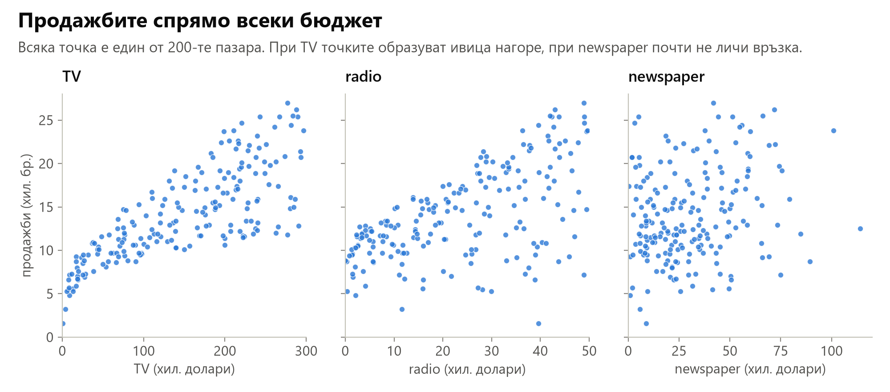

При TV точките образуват ясна ивица нагоре, при radio са по-разпилени, а при newspaper връзката почти не се вижда. Идеята на линейната регресия е да прекара през такъв облак от точки права, която показва как средно се променят продажбите с бюджета.

Данните са **наблюдателни**: никой не е разпределял бюджетите по пазарите нарочно, те са такива, каквито са били. Това има значение, когато се говори за причинност ([раздел 7](#talkuvane)).

### Моделът

При един предиктор X моделът е

$$
Y = \beta_0 + \beta_1 X + \varepsilon
$$

Предикторът е входната променлива, наричана още признак (feature). Y е **отговорът**, т.е. целевата променлива (target).

- $\beta_0$ е **свободният член** (intercept): очакваната стойност на Y при X = 0. За рекламните данни това са очакваните продажби без реклама по телевизия.
- $\beta_1$ е **наклонът** (slope): с колко се променя средно Y, когато X нарасне с единица.
- $\varepsilon$ е **грешката** (error term). В нея влиза всичко, което правата не описва: другите рекламни бюджети, цената, сезонът, грешките при измерването и чистата случайност. Приема се, че средно е нула и не зависи от X.

При p предиктора $X_1, X_2, \dots, X_p$ моделът е

$$
Y = \beta_0 + \beta_1 X_1 + \beta_2 X_2 + \dots + \beta_p X_p + \varepsilon
$$

Числата $\beta_0, \beta_1, \dots, \beta_p$ са **коефициентите** на модела. Този случай е в [раздел 6](#mnozhestvena).

Истинската зависимост почти никога не е точно права. Правата е приближение, но в диапазона на данните често е достатъчно близо до истинската зависимост, за да е полезна. Затова статистикът Джордж Бокс казва: "Всички модели са погрешни, но някои са полезни."

### Истинската и научената права

Коефициентите $\beta_0$ и $\beta_1$ не са известни. Те описват истинската права за всички възможни пазари, а данните съдържат само 200 от тях. От данните се получават **оценки** $\hat\beta_0$ и $\hat\beta_1$, като шапката означава оценена стойност. С тях прогнозата за пазар с бюджет $x$ е

$$
\hat y = \hat\beta_0 + \hat\beta_1 x
$$

Важно е да се различават двете прави:

- **истинската права** $\beta_0 + \beta_1 X$ не е известна;
- **научената права** $\hat\beta_0 + \hat\beta_1 X$ зависи от данните. С други 200 пазара тя щеше да е малко по-различна.

Колко по-различна, показва стандартната грешка от [раздел 4](#tochnost).

### Пример с пет пазара

За да могат сметките да се проследят на ръка, следващите раздели използват пет измислени пазара в мащаба на рекламните данни:

| Пазар | TV бюджет $x$ (хил. долари) | продажби $y$ (хил. бр.) |
|:---:|---:|---:|
| 1 | 50 | 10 |
| 2 | 100 | 11 |
| 3 | 150 | 14 |
| 4 | 200 | 16 |
| 5 | 250 | 19 |

### Колко голяма е грешката: дисперсия

Грешката е различна за всеки пазар: понякога продажбите са над правата, понякога под нея. Средно тя е нула, затова важното е колко се разпилява. Мярката за разпиляване е **дисперсията** (variance): средният квадрат на отклонението от средното. За n стойности $x_1, \dots, x_n$ със средно $\bar x$ тя е

$$
s^2 = \frac{1}{n - 1} \sum_{i=1}^{n} (x_i - \bar x)^2
$$

Коренът от дисперсията е **стандартното отклонение** $s$. То е в същите единици като данните и показва типичното отклонение от средното.

За продажбите на петте пазара:

- средното е 14, а отклоненията от него са -4, -3, 0, 2 и 5;
- сумата на отклоненията винаги е 0, затова се вземат квадратите им: 16, 9, 0, 4 и 25, със сума 54;
- дисперсията е 54 / 4 = 13.5, а стандартното отклонение е $\sqrt{13.5} \approx 3.67$ хиляди бройки.

Квадратите са в "хиляди бройки на квадрат", затова за тълкуване се използва коренът. Дели се на n - 1, а не на n, защото средното е изчислено от същите данни. При една-единствена стойност средното съвпада с нея и отклонението е 0, макар разсейването на величината да не е нула. В pandas `.var()` дели на n - 1 и дава 13.5, а `np.var` дели на n и дава 10.8.

За грешката дисперсията се означава с $\sigma^2 = \mathrm{Var}(\varepsilon)$, а стандартното отклонение с $\sigma$. Средното на ε е нула, затова $\sigma^2$ е просто средният квадрат на грешката, т.е. колко типично се отклоняват наблюденията от **истинската** права. Тази грешка е **неотстранима**: дори с истинските $\beta_0$ и $\beta_1$ прогнозата щеше да греши с около $\sigma$. Самата ε не може да се изчисли, защото истинската права не е известна. Как $\sigma$ се оценява от данните, е обяснено в [раздел 3](#rse-r2).

### Защо линеен модел

Линейната регресия изглежда проста, но е полезна:

- **Тълкува се лесно.** Всеки коефициент казва с колко се променя прогнозата, когато се промени един предиктор.
- **Обучава се бързо.** Коефициентите се намират с формула, без търсене.
- **Често е добра отправна точка.** Преди по-сложен модел се проверява колко постига линейният.
- **Стои в основата на по-сложни методи.** Логистичната регресия за класификация, ridge и lasso, дори всеки неврон в невронна мрежа започват с линейна комбинация $\beta_0 + \beta_1 X_1 + \dots + \beta_p X_p$.

## 2. Как се намира правата

### Остатъци

**Остатъкът** (residual) за наблюдение $i$ е разликата между действителната стойност и прогнозата:

$$
e_i = y_i - \hat y_i
$$

Положителен остатък означава, че точката е над правата: моделът е прогнозирал по-малко от наблюдаваното. Отрицателен остатък означава, че точката е под правата. На графиката остатъкът е **вертикалното** разстояние от точката до правата, защото правата прогнозира y по дадено x, а не обратното.

Остатъкът $e_i$ и грешката $\varepsilon_i$ са различни неща. Грешката е отклонението от истинската права и не е известна. Остатъкът е отклонението от научената права и се изчислява от данните, т.е. той е нещо като оценка на грешката.

### RSS

**Сумата от квадратите на остатъците** (residual sum of squares) е

$$
\mathrm{RSS} = e_1^2 + e_2^2 + \dots + e_n^2 = \sum_{i=1}^{n} (y_i - \hat y_i)^2
$$

Тя измерва общото несъответствие между наблюденията и правата. Защо квадрати, а не просто сума на остатъците?

- Положителните и отрицателните остатъци не се съкращават. Сумата на остатъците на най-добрата права винаги е нула, макар правата да не минава през точките.
- Голямата грешка се наказва повече от няколко малки: остатък 2 дава 4, а два остатъка по 1 дават 2.
- RSS е гладка функция на коефициентите и минимумът ѝ се намира с формула.

Може да се минимизира и сумата от абсолютните стойности $\sum |e_i|$. Тя е по-малко чувствителна към отделни големи грешки, но няма проста формула за решението. Затова моделът обикновено се обучава с RSS, а прогнозите се оценяват и със средната абсолютна грешка MAE.

За петте пазара и правата $\hat y = 7.1 + 0.046x$ (откъде идват тези числа, е обяснено по-долу) прогнозите, остатъците и квадратите им са:

| $x_i$ | $y_i$ | $\hat y_i$ | $e_i$ | $e_i^2$ |
|---:|---:|---:|---:|---:|
| 50 | 10 | 9.4 | 0.6 | 0.36 |
| 100 | 11 | 11.7 | -0.7 | 0.49 |
| 150 | 14 | 14.0 | 0.0 | 0.00 |
| 200 | 16 | 16.3 | -0.3 | 0.09 |
| 250 | 19 | 18.6 | 0.4 | 0.16 |
| **сума** | | | **0.0** | **1.10** |

RSS е сумата на последната колона: 1.10.

### Метод на най-малките квадрати

Всяка двойка числа $(\beta_0, \beta_1)$ задава една права и един RSS. **Методът на най-малките квадрати** (least squares) избира двойката с най-малък RSS. Името идва точно от това: търси се правата, при която сборът от квадратите на остатъците е най-малък.

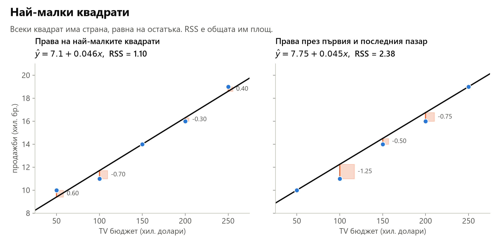

Лявата права е тази с най-малък RSS. Дясната минава точно през първия и последния пазар и изглежда разумна, но остатъците ѝ при средните пазари са по-големи и RSS е повече от два пъти по-голям.

### Формулите

При един предиктор минимумът на RSS се намира с формула:

$$
\hat\beta_1 = \frac{\sum_{i=1}^{n} (x_i - \bar x)(y_i - \bar y)}{\sum_{i=1}^{n} (x_i - \bar x)^2},
\qquad
\hat\beta_0 = \bar y - \hat\beta_1 \bar x
$$

където $\bar x$ и $\bar y$ са средните стойности. Точно това изчислява `LinearRegression().fit`.

- **Числителят** на $\hat\beta_1$ събира произведенията на отклоненията от средните. Пазар с бюджет над средния и продажби над средните дава положително произведение. Ако това е типично, наклонът е положителен.
- **Знаменателят** измерва колко са разпилени бюджетите около средния си.
- Втората формула означава, че правата винаги минава през точката $(\bar x, \bar y)$: при среден бюджет прогнозата е средните продажби.

За петте пазара $\bar x = 150$ и $\bar y = 14$. Колоната "произведение" е $(x_i - \bar x)(y_i - \bar y)$:

| xᵢ | yᵢ | xᵢ - x̄ | yᵢ - ȳ | произведение | (xᵢ - x̄)² |
|---:|---:|---:|---:|---:|---:|
| 50 | 10 | -100 | -4 | 400 | 10000 |
| 100 | 11 | -50 | -3 | 150 | 2500 |
| 150 | 14 | 0 | 0 | 0 | 0 |
| 200 | 16 | 50 | 2 | 100 | 2500 |
| 250 | 19 | 100 | 5 | 500 | 10000 |
| **сума** | | | | **1150** | **25000** |

$$
\hat\beta_1 = \frac{1150}{25000} = 0.046,
\qquad
\hat\beta_0 = 14 - 0.046 \cdot 150 = 7.1
$$

Откъде идват формулите

RSS е функция на двете неизвестни $\beta_0$ и $\beta_1$:

$$
\mathrm{RSS}(\beta_0, \beta_1) = \sum_{i=1}^{n} (y_i - \beta_0 - \beta_1 x_i)^2
$$

В минимума двете частни производни са нула:

$$
\frac{\partial\, \mathrm{RSS}}{\partial \beta_0} = -2 \sum_{i=1}^{n} (y_i - \beta_0 - \beta_1 x_i) = 0,
\qquad
\frac{\partial\, \mathrm{RSS}}{\partial \beta_1} = -2 \sum_{i=1}^{n} x_i (y_i - \beta_0 - \beta_1 x_i) = 0
$$

Първото уравнение казва, че сумата на остатъците е нула, и дава $\beta_0 = \bar y - \beta_1 \bar x$. Когато това се замести във второто уравнение, се получава формулата за $\hat\beta_1$.

### Правата за рекламните данни

С всички 200 пазара $\hat\beta_0 = 7.03$ и $\hat\beta_1 = 0.0475$. Продажбите са в хиляди бройки, а бюджетите в хиляди долари, затова:

- **наклонът** 0.0475 означава, че още 1000 долара за TV реклама се свързват средно с 0.0475 хиляди, т.е. с около 47.5 допълнителни продажби;
- **свободният член** 7.03 означава, че при нулев TV бюджет очакваните продажби са около 7030 бройки. Те идват от другата реклама и от всичко останало.

Думата "свързват" е избрана нарочно. Коефициентът описва връзка в наблюдаваните данни, а не доказва, че рекламата е причинила продажбите ([раздел 7](#talkuvane)).

### RSS като купа

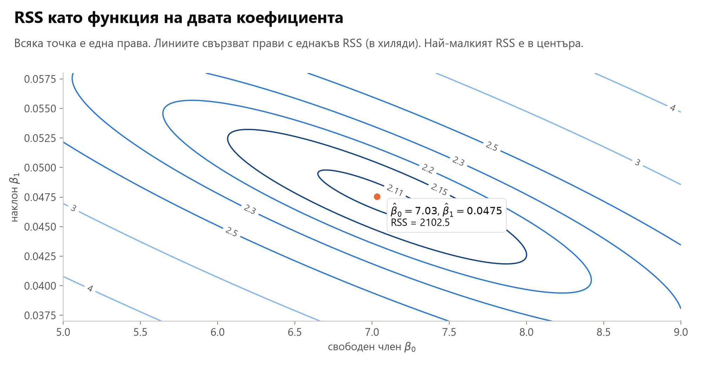

Всяка точка на графиката е една права, а линиите свързват прави с еднакъв RSS. Над равнината на двата коефициента RSS прилича на купа, а методът на най-малките квадрати намира дъното ѝ. Елипсите са наклонени, защото по-голям свободен член може отчасти да се компенсира с по-малък наклон.

### Обучение наведнъж и на стъпки

Обучението на модел означава да се изберат параметрите му така, че грешката върху обучаващите данни да е малка. При линейната регресия параметрите са коефициентите, а грешката е RSS. Дъното на купата се намира с формула, наведнъж. Затова `LinearRegression` няма начални стойности, скорост на обучение и епохи, а резултатът винаги е един и същ.

За повечето други модели такава формула няма и дъното се търси на стъпки. Започва се от някакви коефициенти и на всяка стъпка те се местят малко надолу по стената на купата, в посоката, в която RSS намалява най-бързо. Това е **градиентно спускане** (gradient descent). При линейната регресия то стига до същата права. За рекламните данни, започнато от нулеви коефициенти, след 10 стъпки дава $6.28 + 0.0424 \cdot \text{TV}$, а след 50 стъпки $7.03 + 0.0475 \cdot \text{TV}$, колкото формулата. За да върви спускането добре, бюджетите първо се стандартизират. Ако на всяка стъпка се гледа само по един пример, методът се нарича стохастично градиентно спускане. В scikit-learn това е `SGDRegressor`.

## 3. Колко добре правата описва данните

### RSE

Остатъците са видимото подобие на грешките, затова от тях се оценява $\sigma$:

$$
\hat\sigma^2 = \frac{\mathrm{RSS}}{n - 2},
\qquad
\mathrm{RSE} = \hat\sigma = \sqrt{\frac{\mathrm{RSS}}{n - 2}}
$$

RSE е **остатъчната стандартна грешка** (residual standard error). Тя показва с колко типично се отклоняват наблюденията от правата и е в единиците на Y. За петте пазара:

- остатъците са 0.6, -0.7, 0, -0.3 и 0.4, а средното им е 0;
- квадратите им са 0.36, 0.49, 0, 0.09 и 0.16, със сума RSS = 1.10;
- $\hat\sigma^2 = 1.10 / 3 \approx 0.37$ и $\mathrm{RSE} = \sqrt{0.37} \approx 0.61$ хиляди бройки.

Сметката е като при дисперсията в [раздел 1](#ideya), с две разлики. Отклоненията се мерят от правата, а не от средното. И се дели на n - 2, защото правата има два коефициента, научени от същите данни.

Защо точно n - 2? Истинската права също е една от възможните прави, а методът на най-малките квадрати избира правата с най-малък RSS. Затова RSS никога не е по-голям от сумата на квадратите на истинските грешки и остатъците подценяват грешката. С два пазара правата минава точно през двете точки и RSS = 0, макар грешките да не са нула. Делението на n - 2 поправя това, като изважда двете "изразходвани" наблюдения. В симулация с известна истинска права, $\sigma^2 = 0.36$ и пет пазара RSS / n дава средно 0.22, а RSS / (n - 2) дава средно 0.36. При 200 пазара разликата е само 1%.

За рекламните данни RSS = 2102.5, затова $\hat\sigma^2 = 2102.5 / 198 \approx 10.62$ и RSE = 3.26. Действителните продажби се отклоняват от правата средно с около 3260 бройки. Средните продажби са около 14 хиляди бройки, т.е. грешката е около 23%. Дали това е много, зависи от задачата. Стандартното отклонение на самите продажби е 5.22, т.е. правата с TV намалява типичното отклонение от 5.22 около средното до 3.26 около правата.

### R²

RSE е в единиците на Y и не винаги е ясно дали стойността е голяма. **R²** е дял между 0 и 1:

$$
R^2 = \frac{\mathrm{TSS} - \mathrm{RSS}}{\mathrm{TSS}} = 1 - \frac{\mathrm{RSS}}{\mathrm{TSS}},
\qquad
\mathrm{TSS} = \sum_{i=1}^{n} (y_i - \bar y)^2
$$

- **TSS** (total sum of squares) е общата изменчивост на Y преди регресията. Това е RSS на постоянната прогноза $\bar y$, която в scikit-learn прави `DummyRegressor`.
- **RSS** е изменчивостта, която остава след регресията.
- **R²** е делът от изменчивостта на Y, обяснен от модела, т.е. каква част от грешката на постоянната прогноза премахва правата.

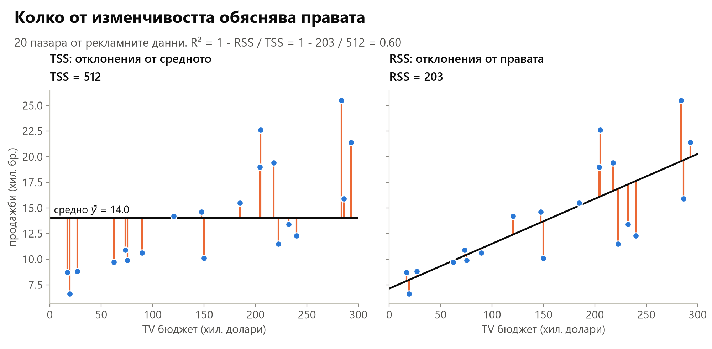

За петте пазара TSS = 16 + 9 + 0 + 4 + 25 = 54, същата сума като при дисперсията на продажбите, и $R^2 = 1 - 1.10 / 54 = 0.98$. За всички 200 пазара и TV: RSS = 2102.5, TSS = 5417.1 и $R^2 = 0.612$. TV рекламата обяснява 61.2% от изменчивостта на продажбите.

R² близо до 1 означава, че моделът обяснява голяма част от изменчивостта. R² близо до 0 може да означава, че връзката не е линейна, че шумът е голям, или и двете. Кое R² е добро, зависи от областта. Във физиката може да се очаква R² много близо до 1, а в биологията, психологията или маркетинга и R² под 0.1 може да е реалистично.

### R² и корелацията

При проста линейна регресия $R^2 = r^2$, където $r$ е **корелацията** между X и Y. За TV r = 0.782 и $r^2 = 0.612$. За петте пазара r = 0.990 и $r^2 = 0.98$. Корелацията обаче е мярка за две променливи. R² работи и с много предиктори: тогава то е квадратът на корелацията между действителните стойности и прогнозите.

### Описване и прогнозиране

RSS, RSE и R² по-горе са изчислени със същите данни, с които е обучен моделът. Те показват колко добре правата **описва** тези данни. Колко добре **прогнозира** нови пазари, се вижда от отделени тестови данни, които не са участвали в обучението. Тестовото R² може да е и отрицателно, ако моделът е по-лош от постоянната прогноза.

## 4. Колко точни са коефициентите

### Стандартна грешка

Ако се съберат данни от други 200 пазара, научената права ще е малко по-различна. Оценката $\hat\beta_1$ зависи от това кои пазари са попаднали в извадката. **Стандартната грешка** (standard error, SE) показва колко се мени оценката при повторни извадки.

Подобно е със средната стойност. Ако средният ръст на студентите се оценява по 10 случайни студенти, оценката може да е доста далеч от истинската. Ако се оценява по 1000 студенти, ще е много по-близо. Стандартната грешка на средното е $\sigma / \sqrt{n}$ и намалява, когато наблюденията се увеличават.

С реални данни истинската права не е известна, но в симулация може да се зададе. Тук истинската права е $7.03 + 0.0475 \cdot \text{TV}$, а шумът е колкото в рекламните данни. От нея се теглят по 10 извадки с 20 и с 200 пазара и за всяка извадка се обучава права:

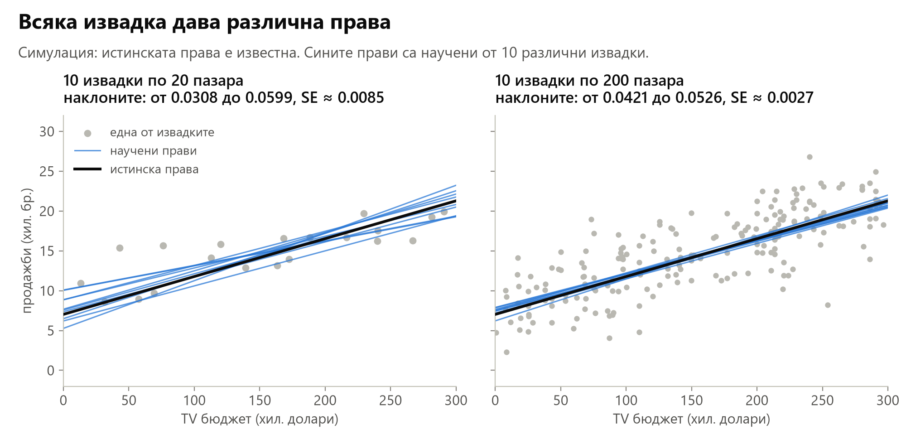

Две неща се виждат от графиката:

- Научените прави се разпределят около истинската, без да са систематично над или под нея. Затова оценката по най-малките квадрати се нарича **неизместена** (unbiased): средното ѝ от много извадки е равно на истинската стойност.
- При 200 пазара правите са много по-близо една до друга, отколкото при 20.

При проста регресия стандартните грешки са

$$
\mathrm{SE}(\hat\beta_1)^2 = \frac{\sigma^2}{\sum_{i=1}^{n} (x_i - \bar x)^2},
\qquad
\mathrm{SE}(\hat\beta_0)^2 = \sigma^2 \left[ \frac{1}{n} + \frac{\bar x^2}{\sum_{i=1}^{n} (x_i - \bar x)^2} \right]
$$

където $\sigma^2 = \mathrm{Var}(\varepsilon)$. Формулата за наклона показва кога оценката е точна:

- **по-малко шум** $\sigma^2$: точките са по-близо до правата;
- **повече наблюдения**: всяко наблюдение добавя член $(x_i - \bar x)^2$ към знаменателя;
- **по-разпилени стойности на X**: ако всички бюджети са близо до средния, наклонът се определя трудно. Все едно линия се прекарва през две много близки точки: малко отместване на едната силно променя наклона.

При петте пазара: ако бюджетите бяха 140, 145, 150, 155 и 160 вместо от 50 до 250, сумата $\sum (x_i - \bar x)^2$ щеше да е 1000 вместо 25000, т.е. 25 пъти по-малка. При същия шум стандартната грешка на наклона щеше да е $\sqrt{25} = 5$ пъти по-голяма.

$\sigma$ не е известна, затова във формулите се използва оценката RSE от [раздел 3](#rse-r2). За петте пазара RSE = 0.61 и

$$
\mathrm{SE}(\hat\beta_1) = \frac{0.61}{\sqrt{25000}} = \frac{0.61}{158.1} \approx 0.0038
$$

За рекламните данни $\mathrm{SE}(\hat\beta_1) = 0.0027$ и $\mathrm{SE}(\hat\beta_0) = 0.458$. В симулацията стандартното отклонение на наклоните от 4000 извадки по 200 пазара също е 0.0027. При 20 пазара то е около 0.009, т.е. около три пъти по-голямо: с 10 пъти по-малко наблюдения SE расте около $\sqrt{10} \approx 3.2$ пъти.

Формулите предполагат, че грешките на различните пазари не са свързани помежду си и имат еднаква дисперсия $\sigma^2$. При рекламните данни второто не е съвсем вярно: разсейката на остатъците расте с прогнозата ([раздел 12](#nelineinost)). Тогава SE може да се оцени и без формулата. От самите данни се теглят много повторни извадки с връщане, за всяка се обучава права и се гледа колко се менят наклоните. Този подход се нарича **bootstrap**. При рекламните данни разсейката на наклоните излиза малко по-голяма от формулата.

### Доверителен интервал

Една оценка, например $\hat\beta_1 = 0.0475$, не казва колко може да ѝ се вярва. **Доверителният интервал** (confidence interval) дава граници около оценката. Приблизителният 95% интервал е

$$
\hat\beta_1 \pm 2 \cdot \mathrm{SE}(\hat\beta_1)
$$

Какво означава "95%": ако се вземат много извадки и за всяка се построи такъв интервал, около 95% от интервалите ще съдържат истинското $\beta_1$. Следващата графика показва 20 извадки от симулацията по-горе:

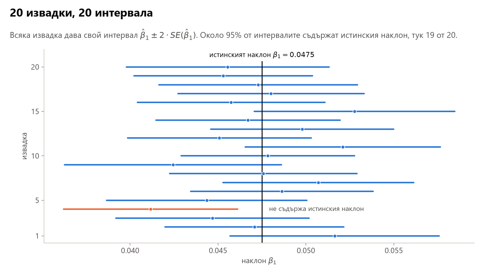

Интервалите са различни, защото всяка извадка дава своя оценка и своя SE. Деветнадесет от тях съдържат истинския наклон, а един не го съдържа. В реалните данни има само един интервал и не може да се каже дали той е от улучилите. Затова 95% е свойство на начина, по който се строи интервалът, а не на един конкретен интервал.

За правата с TV:

| Коефициент | Оценка | SE | 95% интервал |
|---|---:|---:|---|
| $\beta_0$ | 7.0326 | 0.4578 | от 6.130 до 7.935 |
| $\beta_1$ | 0.0475 | 0.0027 | от 0.042 до 0.053 |

Тълкуване: без реклама по телевизия средните продажби са между 6130 и 7935 бройки, а всеки допълнителни 1000 долара за TV се свързват със средно между 42 и 53 бройки повече.

Числото 2 е закръглено. Точният множител за 95% зависи от броя на наблюденията (квантил на t-разпределението с $n - 2$ степени на свобода). При 200 пазара той е 1.97, затова 2 е добро приближение. Интервалите в таблицата са с 1.97. При малко наблюдения разликата е голяма: при петте пазара множителят е 3.18, а не 2.

## 5. Има ли изобщо връзка

Дори TV рекламата изобщо да не е свързана с продажбите, научената права почти никога няма да е напълно хоризонтална. Заради шума $\hat\beta_1$ ще е малко над или под нулата. Въпросът е дали $\hat\beta_1 = 0.0475$ е достатъчно далеч от нулата, за да не може да се обясни с шум.

### Нулева хипотеза и t-статистика

Проверката започва с **нулева хипотеза** (null hypothesis) и алтернатива:

- $H_0$: няма връзка между X и Y, т.е. $\beta_1 = 0$;
- $H_a$: има някаква връзка, т.е. $\beta_1 \neq 0$.

**t-статистиката** измерва на колко стандартни грешки е оценката от нулата:

$$
t = \frac{\hat\beta_1 - 0}{\mathrm{SE}(\hat\beta_1)}
$$

За TV $t = 0.0475 / 0.0027 = 17.67$. Оценката е на почти 18 стандартни грешки от нулата.

### p-стойност

Ако $H_0$ е вярна, t се разпределя по t-разпределението с $n - 2$ степени на свобода. При повече от около 30 наблюдения то почти съвпада с нормалното разпределение. **p-стойността** (p-value) е вероятността, ако $H_0$ е вярна, да се получи t поне толкова далеч от нулата, колкото наблюдаваното. На графиката това е площта под кривата в двете опашки:

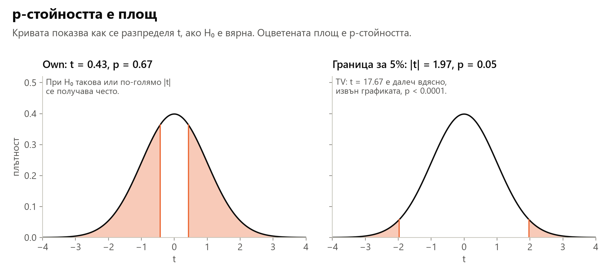

- Вляво е моделът с индикатора `Own` от [раздел 10](#kachestveni), който сравнява средния баланс по кредитната карта на клиентите със и без собствено жилище: t = 0.43 и p = 0.67. Ако между двете групи няма разлика, t поне толкова далеч от нулата се получава в 67% от случаите. Няма основание $H_0$ да се отхвърли.
- Вдясно е границата за 5%: t = ±1.97. За TV t = 17.67 е толкова далеч вдясно, че площта е практически нула: p < 0.0001.

Малка p-стойност означава, че такава връзка трудно се получава случайно. Тогава $H_0$ се отхвърля и връзката се нарича **статистически значима**. Обичайните прагове са 5% и 1%. При t около 2 p-стойността е около 0.05, затова проверката и доверителният интервал са два погледа към едно и също: 95% интервал, който не съдържа нулата, съответства на p < 0.05.

Две уточнения:

- "Не е значим" означава "няма доказателство за връзка", а не "доказано е, че няма връзка". Може просто данните да са малко или шумни.
- "Значим" не означава "голям" или "важен". При много данни и съвсем малък ефект може да е значим.

Резултатите обикновено се показват в таблица. За правата с TV:

| | Коефициент | SE | t | p |
|---|---:|---:|---:|---:|
| свободен член | 7.0326 | 0.4578 | 15.36 | < 0.0001 |
| TV | 0.0475 | 0.0027 | 17.67 | < 0.0001 |

И двете p-стойности са под 0.0001: данните дават много силно доказателство за връзка между TV рекламата и продажбите. scikit-learn не изчислява стандартни грешки и p-стойности. За тях се използва библиотеката statsmodels, а SE може да се изчисли и по формулата от [раздел 4](#tochnost).

## 6. Няколко предиктора едновременно

Три отделни прости регресии, по една за всеки бюджет, не са достатъчни:

- не е ясно как от три прави да се получи една прогноза за пазар с дадени три бюджета;
- всяка проста регресия пренебрегва другите два бюджета. Ако бюджетите са свързани помежду си, коефициентите стават подвеждащи, както показва примерът с вестниците по-долу.

Затова всички предиктори се включват в един модел, **множествена линейна регресия**:

$$
Y = \beta_0 + \beta_1 X_1 + \beta_2 X_2 + \dots + \beta_p X_p + \varepsilon
$$

За рекламните данни:

$$
\text{sales} = \beta_0 + \beta_1 \cdot \text{TV} + \beta_2 \cdot \text{radio} + \beta_3 \cdot \text{newspaper} + \varepsilon
$$

### Тълкуване

$\beta_j$ е средната промяна на Y при увеличаване на $X_j$ с единица, **ако всички останали предиктори са фиксирани**. Например $\beta_2$ сравнява пазари с еднакви бюджети за TV и вестници, които се различават само по бюджета за радио. Това е различно от наклона на проста регресия само с radio, при която другите бюджети се менят свободно.

### Оценяване

Коефициентите отново се избират с най-малки квадрати:

$$
\mathrm{RSS} = \sum_{i=1}^{n} (y_i - \hat\beta_0 - \hat\beta_1 x_{i1} - \hat\beta_2 x_{i2} - \dots - \hat\beta_p x_{ip})^2
$$

Тук $x_{ij}$ е стойността на предиктор $j$ за наблюдение $i$. Решението се записва с матрици и се изчислява от софтуер, например с `LinearRegression().fit(X, y)` в scikit-learn. Прогнозата е

$$
\hat y = \hat\beta_0 + \hat\beta_1 x_1 + \hat\beta_2 x_2 + \dots + \hat\beta_p x_p
$$

### Геометрия

При един предиктор моделът е права в равнината. При два предиктора е **равнина** в тримерното пространство: по едната ос е $X_1$, по другата $X_2$, а височината е Y. Остатъците са **вертикалните** разстояния от точките до равнината. Най-малките квадрати избират равнината с най-малък сбор от квадратите на тези разстояния. При повече предиктори моделът е хиперравнина, която не може да се начертае, но сметките са същите.

### Резултатите за рекламните данни

| | Коефициент | SE | t | p |
|---|---:|---:|---:|---:|
| свободен член | 2.939 | 0.3119 | 9.42 | < 0.0001 |
| TV | 0.046 | 0.0014 | 32.81 | < 0.0001 |
| radio | 0.189 | 0.0086 | 21.89 | < 0.0001 |
| newspaper | -0.001 | 0.0059 | -0.18 | 0.8599 |

- При фиксирани radio и newspaper още 1000 долара за TV се свързват с около 46 продажби повече.
- При фиксирани TV и newspaper още 1000 долара за радио се свързват с около 189 продажби повече.
- Коефициентът на newspaper е почти нула и p = 0.86: когато бюджетите за TV и радио са известни, бюджетът за вестници не добавя информация.

### Защо вестниците изглеждат полезни сами

В проста регресия само с newspaper коефициентът е 0.055 (SE 0.017, p = 0.001) и е значим. В множествената регресия е почти нула. Как може един и същ бюджет да е значим в единия модел и незначим в другия?

Отговорът е в корелациите между променливите:

| | TV | radio | newspaper | sales |
|---|---:|---:|---:|---:|
| TV | 1.0000 | 0.0548 | 0.0567 | 0.7822 |
| radio | | 1.0000 | 0.3541 | 0.5762 |
| newspaper | | | 1.0000 | 0.2283 |
| sales | | | | 1.0000 |

Корелацията между radio и newspaper е 0.35: на пазарите, където се харчи повече за радио, се харчи повече и за вестници. А радиото е свързано с продажбите. Простата регресия с newspaper вижда, че на пазарите с много реклама във вестници продажбите са по-високи, и приписва на вестниците ефекта на радиото. Вестниците са **заместител** (surrogate) на радиото.

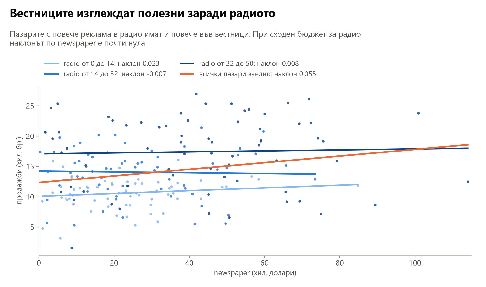

Пазарите са разделени на три групи по бюджета за радио. От група към група растат и продажбите, и вестниците, затова общата права (оранжевата) е наклонена нагоре. В една група, т.е. при сходен бюджет за радио, наклонът по newspaper е почти нула. Множествената регресия прави същото, но по-точно: сравнява пазари при фиксирани TV и radio.

Същата логика има и в следния пример. На един плаж в дните, когато се продава повече сладолед, има и повече нападения от акули. Регресия на нападенията спрямо продажбите на сладолед ще покаже положителна връзка, но никой не предлага сладоледът да се забрани. И двете растат в горещите дни, когато на плажа има повече хора. Ако температурата е в модела, сладоледът вече не е свързан с нападенията.

## 7. Тълкуване на коефициентите

### Некорелирани предиктори: балансиран дизайн

Най-лесният случай е, когато предикторите не са корелирани помежду си. Такъв **балансиран дизайн** се получава в експеримент, например ако бюджетите за TV и радио се разпределят по пазарите независимо един от друг. Тогава:

- всеки коефициент може да се оцени и провери отделно, а простата и множествената регресия дават почти еднакви коефициенти;
- тълкуването "промяна на $X_j$ с единица се свързва с промяна на Y с $\beta_j$, докато останалите предиктори са фиксирани" е смислено.

### Корелирани предиктори

В наблюдателни данни предикторите обикновено са корелирани. Това създава два проблема:

- **Дисперсията на коефициентите расте**, понякога драматично. Когато два предиктора се движат заедно, данните не могат да разделят ефектите им. Например при цените на жилища площта и броят на стаите растат заедно. Голям коефициент на площта и малък на стаите описват данните почти толкова добре, колкото обратното, затова стандартните грешки и на двата коефициента стават големи.
- **Тълкуването става опасно.** "Промяна на $X_j$ при фиксирани останали" може да описва ситуация, която в данните почти не се среща: голямо жилище с малко стаи. Когато в действителност $X_j$ се промени, променят се и останалите предиктори.

### Знакът може да изненада

Два класически примера от книгата на Mosteller и Tukey показват колко зависи коефициентът от останалите предиктори.

**Монетите.** Y е сумата на монетите в джоба. $X_1$ е общият брой монети, а $X_2$ е броят на дребните монети. Сам по себе си $X_2$ е свързан положително с Y: повече дребни монети, повече пари. Но ако $X_1$ също е в модела, коефициентът на $X_2$ става **отрицателен**. При фиксиран общ брой монети всяка дребна монета повече означава една едра монета по-малко, т.е. по-малко пари.

**Ръстът и теглото.** Y е броят отнемания на топката (tackles), които играч по американски футбол прави за един сезон, W е теглото му, а H е ръстът му. Напасната регресия е $\hat Y = b_0 + 0.50 W - 0.10 H$. Отрицателният коефициент на ръста не означава, че по-високите играчи отнемат топката по-рядко. Означава, че между играчи с **еднакво тегло** по-високите отнемат малко по-рядко. При еднакво тегло по-високият играч е по-лек за ръста си.

В двата примера знакът зависи от това кои други предиктори са в модела. Коефициентът отговаря на въпроса какво се променя при фиксирани останали предиктори, а не на въпроса какво се променя изобщо.

### Причинност

Коефициентите от наблюдателни данни показват **връзка**, а не **причина**. Ако по-големите градове получават и по-големи рекламни бюджети, а в тях продажбите и без това са по-високи, коефициентът на TV включва и ефекта от размера на града. Твърдения за причинност трябва да се избягват без подходящ експериментален дизайн.

Mosteller и Tukey го казват така: "За да разберем какво ще стане при намеса в сложна система, трябва действително да се намесим, а не само да я наблюдаваме." За да се разбере дали рекламата причинява продажби, е нужен експеримент, например рекламните бюджети да се разпределят случайно между пазарите.

## 8. Моделът като цяло и прогнозите

### Има ли поне един полезен предиктор?

Нулевата хипотеза е, че нито един предиктор не е свързан с Y:

- $H_0$: $\beta_1 = \beta_2 = \dots = \beta_p = 0$;
- $H_a$: поне едно $\beta_j$ не е нула.

Проверява се с **F-статистиката**:

$$
F = \frac{(\mathrm{TSS} - \mathrm{RSS}) / p}{\mathrm{RSS} / (n - p - 1)}
$$

- Числителят е подобрението спрямо постоянната прогноза, разделено на броя на предикторите.
- Знаменателят е оценка на шума $\sigma^2$.

Ако $H_0$ е вярна, двете части са приблизително равни и F е около 1. Ако някой предиктор е полезен, числителят е по-голям и F е много над 1. За рекламните данни с трите бюджета F = 570 (RSE = 1.69 и R² = 0.897), а p-стойността е практически нула: поне един бюджет със сигурност е свързан с продажбите.

Защо не стига да се погледнат p-стойностите на отделните коефициенти? Ако има 100 предиктора и нито един не е свързан с Y, около 5 от тях пак ще имат p < 0.05 само по случайност. F-статистиката отчита броя на предикторите и няма този проблем. При един предиктор $F = t^2$: за правата с TV $F = 17.67^2 = 312$.

### RSE и R² при много предиктори

Мерките от [раздел 3](#rse-r2) работят и тук, но с две особености:

- **R² винаги расте**, когато се добави предиктор, дори безполезен, защото RSS върху данните за обучение не може да се увеличи. С TV и radio R² = 0.89719, а с добавен newspaper е 0.89721.
- **RSE може да се увеличи.** При p предиктора $\mathrm{RSE} = \sqrt{\mathrm{RSS} / (n - p - 1)}$. Новият предиктор намалява и RSS, и знаменателя. Ако RSS намалее съвсем малко, RSE расте. С TV и radio RSE = 1.681, а с добавен newspaper е 1.686.

Затова R² върху обучаващите данни не стига, за да се реши кои предиктори да останат ([раздел 9](#izbor)).

### Колко точна е прогнозата?

Прогнозата $\hat y$ има три източника на несигурност:

1. **Коефициентите са оценки.** Научената равнина не е истинската. Тази несигурност намалява с повече данни и се описва с **доверителен интервал** за средната стойност на Y.
2. **Моделът е приближение.** Истинската зависимост може да не е линейна ([раздел 12](#nelineinost)).
3. **Грешката ε.** Дори истинските коефициенти да са известни, отделният пазар се отклонява от средното. Тази грешка е неотстранима и се включва в **интервала за прогноза** (prediction interval).

За модела с TV и radio и пазар с TV = 100 и radio = 20 хиляди долара:

| Какво се прогнозира | Прогноза | 95% интервал |
|---|---:|---|
| средните продажби на всички такива пазари (доверителен интервал) | 11.26 | от 10.99 до 11.53 |
| продажбите на един такъв пазар (интервал за прогноза) | 11.26 | от 7.93 до 14.58 |

Двата интервала са около една и съща прогноза, но интервалът за отделен пазар е много по-широк, защото включва и ε.

## 9. Избор на предиктори

Ако F-статистиката показва, че поне един предиктор е полезен, следващият въпрос е кои са полезните. При p предиктора има $2^p$ възможни подмодела, защото всеки предиктор е или в модела, или извън него. При 3 предиктора подмоделите са 8 и могат да се сравнят всички. При 20 са над милион, а при 30 над милиард. Затова пълното изчерпване става невъзможно и е нужен автоматичен подход.

**Последователен избор напред** (forward selection):

1. Започва се с **нулевия модел**: само свободен член, т.е. постоянна прогноза $\bar y$.
2. Обучават се p модела, всеки с един предиктор. Добавя се този с най-малък RSS.
3. Към текущия модел се пробва всеки от останалите предиктори. Добавя се този, който намалява RSS най-много.
4. Стъпка 3 се повтаря, докато се изпълни правило за спиране: например новият предиктор вече не е значим или коригираното R² (по-долу) спре да расте.

**Последователен избор назад** (backward selection):

1. Започва се с всички предиктори.
2. Премахва се най-малко полезният, обикновено този с най-голяма p-стойност.
3. Моделът се обучава отново и стъпка 2 се повтаря, докато всички останали предиктори са значими, например с p под избран праг.

Изборът назад не може да се използва, ако предикторите са повече от наблюденията: тогава моделът с всички предиктори няма единствено решение. Изборът напред може да се използва винаги. И двата подхода са "алчни": на всяка стъпка правят най-добрия ход в момента и може да пропуснат най-добрия модел. Има и смесен избор, който редува добавяне и премахване.

### Критерии

RSS и R² върху данните за обучение винаги предпочитат модела с повече предиктори, затова не стават за сравнение на модели с различен размер. Използват се критерии, които наказват ненужната сложност:

- **коригирано R²**: $1 - \dfrac{\mathrm{RSS} / (n - p - 1)}{\mathrm{TSS} / (n - 1)}$. Расте само ако новият предиктор намали RSS достатъчно;
- **AIC** и **BIC**: добавят към грешката наказание, което расте с броя на предикторите. BIC наказва по-силно и избира по-малки модели;
- **кръстосана проверка** (cross-validation): оценява грешката директно върху данни, които не са участвали в обучението.

Целта е добра точност върху нови данни без ненужна сложност.

## 10. Качествени предиктори

Някои предиктори са категории, а не числа. Данните Credit описват 400 клиенти: средния баланс по кредитната карта `Balance` и числови предиктори като доход (`Income`, в хиляди долари), кредитен лимит (`Limit`), кредитен рейтинг (`Rating`), брой карти (`Cards`), възраст (`Age`) и години образование (`Education`). Други предиктори са категории: дали клиентът притежава жилище (`Own`), дали е студент (`Student`), дали е семеен (`Married`) и в кой регион живее (`Region`: East, South или West).

### Предиктор с две нива

Категорията се представя с **индикаторна** (фиктивна, dummy) променлива: $x_i = 1$, ако клиентът притежава жилище, и $x_i = 0$, ако не притежава. Моделът

$$
\text{balance}_i = \beta_0 + \beta_1 x_i + \varepsilon_i
$$

дава два случая:

- за собственик ($x_i = 1$): $\text{balance}_i = \beta_0 + \beta_1 + \varepsilon_i$;
- за клиент без жилище ($x_i = 0$): $\text{balance}_i = \beta_0 + \varepsilon_i$.

Затова:

- $\beta_0$ е средният баланс на **базовата група**, тази с индикатор 0 (клиентите без жилище);
- $\beta_0 + \beta_1$ е средният баланс на собствениците;
- $\beta_1$ е средната разлика между двете групи.

За данните Credit $\hat\beta_0 = 509.80$ и $\hat\beta_1 = 19.73$, т.е. средният баланс е 509.80 долара за клиентите без жилище и 529.53 за собствениците. Това са точно средните на двете групи: когато единственият предиктор е индикатор, най-добрата прогноза за всяка група е средното ѝ. Стандартната грешка на разликата е 46.05, t = 0.43 и p = 0.669. Няма статистическо доказателство за разлика в средния баланс между двете групи (графиката в [раздел 5](#hipotezi)).

Кодирането с 0 и 1 не е единственото възможно. С $x_i = 1$ за собственик и $x_i = -1$ за клиент без жилище свободният член става 519.67, средното на двете групови средни, а коефициентът 9.87 е половината от разликата. Прогнозите са същите, променя се само тълкуването на коефициентите.

### Предиктор с повече нива

Регионът има три нива. Използват се две индикаторни променливи:

- $x_{i1} = 1$, ако клиентът е от South, и 0 иначе;
- $x_{i2} = 1$, ако клиентът е от West, и 0 иначе.

Моделът $\text{balance}_i = \beta_0 + \beta_1 x_{i1} + \beta_2 x_{i2} + \varepsilon_i$ дава три случая:

| Регион | $x_{i1}$ | $x_{i2}$ | Среден баланс |
|---|:---:|:---:|---|
| East (базов) | 0 | 0 | $\beta_0$ |
| South | 1 | 0 | $\beta_0 + \beta_1$ |
| West | 0 | 1 | $\beta_0 + \beta_2$ |

**Базовата категория** (baseline) е тази без собствена индикаторна променлива. Коефициентите на индикаторите измерват разликите спрямо нея:

| | Коефициент | SE | t | p |
|---|---:|---:|---:|---:|
| свободен член (East) | 531.00 | 46.32 | 11.46 | < 0.0001 |
| South | -12.50 | 56.68 | -0.22 | 0.826 |
| West | -18.69 | 65.02 | -0.29 | 0.774 |

Средният баланс е 531.00 за East, 518.50 за South и 512.31 за West. Разликите не са значими. F-тестът за двата индикатора заедно ($H_0$: $\beta_1 = \beta_2 = 0$) дава p = 0.96: данните не показват разлика между регионите.

Защо F-тест? p-стойностите на отделните индикатори зависят от избора на базова категория, защото всеки индикатор сравнява една група с базовата. F-тестът проверява всички индикатори заедно и не зависи от този избор.

### Защо q - 1 индикатора

При q категории са необходими **q - 1** индикаторни променливи. Ако се добави и трета колона за East, сборът на трите колони за всеки клиент е 1, колкото е и колоната на свободния член. Тогава едни и същи прогнози могат да се запишат по безброй начини, например с 100 повече в свободния член и със 100 по-малко във всеки от трите коефициента. Коефициентите нямат единствено решение. Затова при one-hot кодиране за линейна регресия със свободен член една колона се изпуска (`drop_first=True` в `pd.get_dummies`).

Защо не едно число, например 0, 1 и 2 за трите региона? Тогава моделът би приел, че регионите имат ред и че разликата между първия и втория е равна на разликата между втория и третия. За регион това няма смисъл. Индикаторите позволяват отделна разлика за всяка група.

### Изборът на базова категория

Изборът на базово ниво променя параметризацията, но не и прогнозите. Ако за база се избере West, свободният член става 512.31, средното на West, а коефициентите стават разликите на другите региони от West. Прогнозата за всяка група остава средният ѝ баланс.

## 11. Взаимодействие

Стандартният линеен модел е **адитивен**: ефектът на един предиктор не зависи от стойностите на другите. За рекламата това означава, че още 1000 долара за TV добавят едно и също към продажбите, независимо дали бюджетът за радио е малък, или голям. Това предположение може да се отслаби, без да се излиза от линейната регресия.

### Синергия

Да предположим, че рекламата по радио прави телевизионната по-ефективна: колкото повече се харчи за радио, толкова повече добавят 1000 долара за TV. Тогава при общ бюджет от 100 000 долара разделянето му поравно между TV и радио може да увеличи продажбите повече, отколкото ако целият бюджет отиде за една от медиите. В маркетинга това се нарича **синергия**, а в статистиката **взаимодействие** (interaction).

В рекламните данни остатъците на модела с TV и radio без взаимодействие имат закономерност. Точките над равнината са главно там, където и двата бюджета са големи. Точките под равнината са там, където почти целият бюджет е в едната медия. Равнината не може да се огъне така, че да ги следва.

### Моделът

Към модела се добавя трети предиктор, произведението на двата бюджета:

$$
\text{sales} = \beta_0 + \beta_1 \cdot \text{TV} + \beta_2 \cdot \text{radio} + \beta_3 \cdot (\text{TV} \times \text{radio}) + \varepsilon
$$

Ако членовете с TV се групират:

$$
\text{sales} = \beta_0 + (\beta_1 + \beta_3 \cdot \text{radio}) \cdot \text{TV} + \beta_2 \cdot \text{radio} + \varepsilon
$$

Наклонът по TV вече не е константа, а $\beta_1 + \beta_3 \cdot \text{radio}$, т.е. зависи от бюджета за радио. По същия начин ефектът на radio е $\beta_2 + \beta_3 \cdot \text{TV}$. Това все още е линейна регресия: произведението е просто нова колона, а моделът е линеен по коефициентите. Обучава се със същите най-малки квадрати.

$\beta_1$ и $\beta_2$ се наричат **главни ефекти** (main effects), а $\beta_3$ е ефектът на взаимодействието.

### Резултатите

| | Коефициент | SE | t | p |
|---|---:|---:|---:|---:|
| свободен член | 6.7502 | 0.248 | 27.23 | < 0.0001 |
| TV | 0.0191 | 0.0015 | 12.70 | < 0.0001 |
| radio | 0.0289 | 0.0089 | 3.24 | 0.0014 |
| TV × radio | 0.0011 | 0.00005 | 20.73 | < 0.0001 |

Коефициентът на взаимодействието е силно значим. R² расте от 89.7% без взаимодействие до 96.8% с него. Моделът без взаимодействие оставя необяснени 100% - 89.7% = 10.3% от изменчивостта. Взаимодействието обяснява 96.8% - 89.7% = 7.1 процентни пункта от тях, т.е. около 69% от необясненото:

$$
\frac{96.8 - 89.7}{100 - 89.7} = \frac{7.1}{10.3} \approx 0.69
$$

### Тълкуването

При фиксиран TV бюджет още 1000 долара за радио увеличават продажбите с $(\hat\beta_2 + \hat\beta_3 \cdot \text{TV}) \cdot 1000$ бройки. Множителят 1000 е, защото продажбите са в хиляди бройки. С числата това е $(0.0289 + 0.0011 \cdot \text{TV}) \cdot 1000 \approx 29 + 1.1 \cdot \text{TV}$ бройки:

| TV бюджет (хил. долари) | още 1000 долара за радио |
|---:|---:|
| 50 | около 83 бройки |
| 150 | около 192 бройки |
| 250 | около 300 бройки |

Оцененият ефект на радиото расте с TV бюджета. По същия начин ефектът на още 1000 долара за TV е $(0.0191 + 0.0011 \cdot \text{radio}) \cdot 1000 \approx 19 + 1.1 \cdot \text{radio}$ бройки: около 30 при radio = 10 и около 63 при radio = 40.

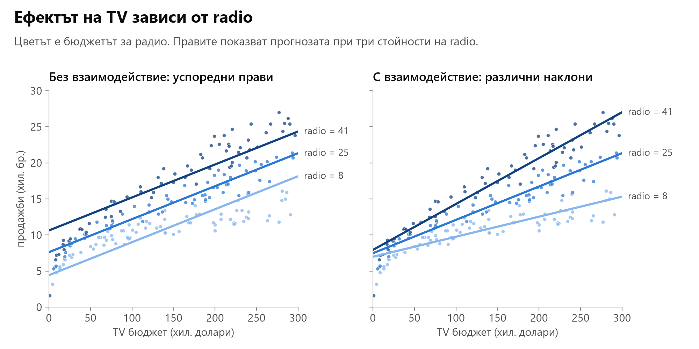

Вляво е моделът без взаимодействие: правите за различни бюджети за радио са успоредни, само изместени нагоре. Вдясно е моделът с взаимодействие: колкото по-голям е бюджетът за радио, толкова по-стръмна е правата по TV. Точките с много реклама по радио (тъмните) следват стръмната права.

Взаимодействието е открито в наблюдателни данни. То описва връзка, а не доказва, че комбинирането на медиите причинява допълнителни продажби.

### Йерархичен принцип

**Йерархичният принцип**: ако в модела има взаимодействие, в него се включват и двата главни ефекта, дори когато p-стойностите им не са значими.

Причината е, че без главните ефекти взаимодействието зависи от произволния избор на нулата на скалата. Бюджетът за радио може да се измерва от нула, но може и като бюджет над 10 хиляди долара, $r = \text{radio} - 10$. Това е същата информация, само с друга нула. Тогава

$$
\text{TV} \times \text{radio} = \text{TV} \times (r + 10) = \text{TV} \times r + 10 \cdot \text{TV}
$$

- **Моделът само с произведението**, $\beta_0 + \beta_3 \cdot \text{TV} \times \text{radio}$, записан с r, съдържа скрит главен ефект на TV с коефициент $10 \beta_3$. Моделът $\beta_0 + \beta_3 \cdot \text{TV} \times r$ е друг модел и дава други прогнози. Резултатът зависи от това къде е сложена нулата.
- **Йерархичният модел**, $\beta_0 + \beta_1 \cdot \text{TV} + \beta_2 \cdot \text{radio} + \beta_3 \cdot \text{TV} \times \text{radio}$, съдържа всички тези членове. При смяна на нулата коефициентите се преподреждат (коефициентът на TV става $\beta_1 + 10 \beta_3$, а свободният член $\beta_0 + 10 \beta_2$), но прогнозите остават същите.

Главните ефекти участват косвено и в произведението, затова не бива да се махат. Произволни нули има навсякъде: температура в градуси по Целзий или по Фаренхайт, година, броена от 0 или от 2000, бюджет, измерван от някакво минимално ниво.

В модела с взаимодействие $\beta_1$ вече не е "ефектът на TV", а ефектът на TV при radio = 0. Затова p-стойността му отговаря на тесен въпрос: има ли ефект от TV, когато за радио не се харчи нищо? Дори отговорът да е "не", взаимодействието показва, че TV има ефект при другите бюджети за радио.

### Качествен и количествен предиктор

Взаимодействие може да има и между категория и число. В данните Credit балансът зависи от дохода (`Income`) и от това дали клиентът е студент (`Student`). Индикаторът $\text{student}_i$ е 1 за студент и 0 за останалите.

**Без взаимодействие** моделът е

$$
\text{balance}_i \approx \beta_0 + \beta_1 \cdot \text{income}_i + \beta_2 \cdot \text{student}_i
$$

и дава две прави:

- за студент: $(\beta_0 + \beta_2) + \beta_1 \cdot \text{income}$;
- за нестудент: $\beta_0 + \beta_1 \cdot \text{income}$.

Двете прави имат еднакъв наклон $\beta_1$ и са **успоредни**. Индикаторът само ги измества нагоре или надолу. Моделът приема, че по-високият доход увеличава баланса еднакво при студенти и нестуденти.

**С взаимодействие** се добавя произведението $\text{income} \times \text{student}$:

$$
\text{balance}_i \approx \beta_0 + \beta_1 \cdot \text{income}_i + \beta_2 \cdot \text{student}_i + \beta_3 \cdot (\text{income}_i \times \text{student}_i)
$$

- за студент: $(\beta_0 + \beta_2) + (\beta_1 + \beta_3) \cdot \text{income}$;
- за нестудент: $\beta_0 + \beta_1 \cdot \text{income}$.

Сега студентите и нестудентите могат да имат различни свободни членове и **различни наклони**. Това е като две отделни прави, по една за всяка група, но в един модел.

## 12. Нелинейни зависимости

Стандартният линеен модел предполага и **линейност**: промяната на Y при промяна на $X_j$ с единица е една и съща при всяка стойност на $X_j$. Първите 1000 долара за TV добавят колкото и стохилядните. И това предположение може да се отслаби, без да се излиза от линейната регресия.

### Полиномиална регресия

Данните Auto съдържат характеристики на модели коли. Зависимостта между разхода на гориво `mpg` (мили на галон, т.е. по-голямо число означава по-икономична кола) и мощността `horsepower` е крива. При слабите коли mpg пада бързо с мощността, а при мощните почти не се променя. Права не може да опише такава форма.

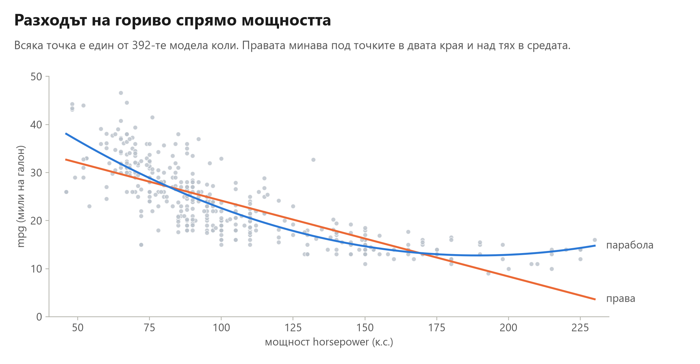

Оранжевата права греши систематично: при слабите и при най-мощните коли точките са главно над нея, а при средните под нея. Синята парабола е моделът с полиномиален член от следващата формула. Тя пада стръмно при малка мощност и се изравнява при голяма, както точките.

Линейният модел се разширява с **полиномиален член**:

$$
\text{mpg} = \beta_0 + \beta_1 \cdot \text{horsepower} + \beta_2 \cdot \text{horsepower}^2 + \varepsilon
$$

Това **все още е линейна регресия**. "Линейна" се отнася за коефициентите, а не за предиктора: $X_1 = \text{horsepower}$ и $X_2 = \text{horsepower}^2$ са просто две колони, а моделът е сбор от коефициенти, умножени по колони. Затова се обучава със същите най-малки квадрати, както взаимодействието с колоната $\text{TV} \times \text{radio}$.

### Колко гъвкав да е моделът

С по-висока степен на полинома моделът следва все по-сложни криви: степен 2 е парабола, степен 3 може да има още един завой и т.н. Полином от достатъчно висока степен минава почти през всички точки, но тогава следва и случайностите в данните. В краищата на данните, където точките са малко, такава крива се извива без причина и прогнозира лошо нови наблюдения. По-гъвкав модел не е непременно по-добър. Колко гъвкав да е моделът, се решава с проверка върху данни, които не са участвали в обучението ([раздел 3](#rse-r2)).

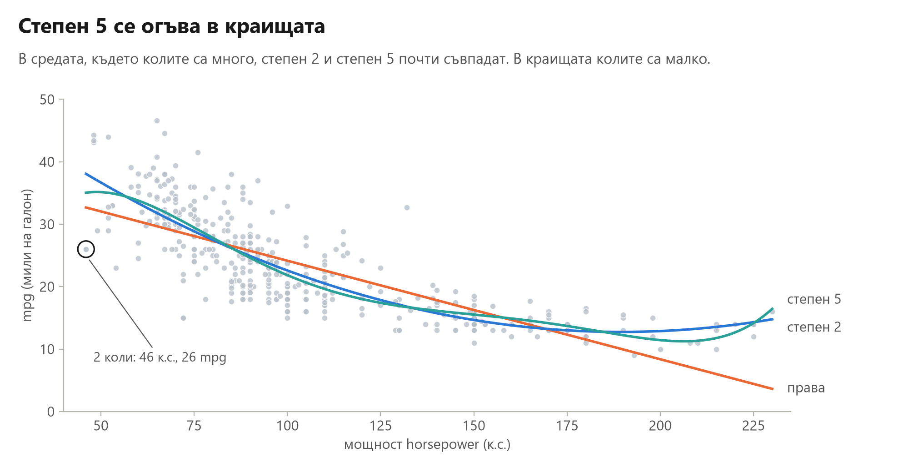

Графиката показва правата, параболата и полином от степен 5. В средата, където колите са много, параболата и степен 5 почти съвпадат. В краищата колите са малко: под 55 к.с. са 13, а над 200 к.с. са 10. Там кривата от степен 5 се огъва след отделни коли. Ако се махнат само двете коли с 46 к.с. и 26 mpg (оградената точка), прогнозата на степен 5 при 46 к.с. се мести от 35.0 на 38.1 mpg, а тази на параболата само от 38.1 на 38.7. Две коли от 392 местят края на кривата от степен 5 с 3 mpg.

### Графиката на остатъците

**Графиката на остатъците** (residual plot) показва остатъка $e_i$ спрямо прогнозата $\hat y_i$ за всяко наблюдение. Ако моделът е описал всичко систематично, точките са разпръснати около нулата без форма. Всяка ясна форма подсказва какво пропуска моделът:

- **крива форма, като буквата U**: зависимостта не е линейна. Остатъците са с еднакъв знак в двата края и с обратния знак в средата. Полиномиален член може да премахне тази форма;
- **фуния**: разсейката расте с прогнозата, т.е. дисперсията на грешката не е постоянна. Такава е графиката на модела само с TV за рекламните данни;
- **отделни далечни точки**: наблюдения, които моделът описва много лошо. Те може да са грешки в данните или необичайни случаи и си струва да се погледнат.

Графиката на остатъците е полезна и при много предиктори, когато самите данни не могат да се начертаят.

## 13. Отвъд линейния модел

Линейният модел е основа за много други методи:

- **Класификация.** Когато отговорът е категория, линейната комбинация $\beta_0 + \beta_1 X_1 + \dots + \beta_p X_p$ се преобразува във вероятност. Това е логистичната регресия. Тя е част от по-широко семейство, **обобщените линейни модели** (generalized linear models).
- **Нелинейност.** Сплайните съшиват полиноми по части. Дърветата на решенията, bagging и boosting сами откриват нелинейности и взаимодействия.
- **Регуляризация.** Ridge и lasso свиват коефициентите към нулата. Така контролират сложността и стабилизират оценките, особено при корелирани предиктори.

## Речник

| Термин | На английски | Значение |
|---|---|---|
| предиктор (признак) | predictor, feature | входна променлива $X_j$ |
| отговор (целева променлива) | response, target | променливата Y, която се прогнозира |
| свободен член | intercept | $\beta_0$, прогнозата, когато всички предиктори са 0 |
| наклон, коефициент | slope, coefficient | $\beta_j$, промяната на Y, когато $X_j$ нарасне с единица, а останалите са фиксирани |
| грешка | error term | $\varepsilon$, всичко, което моделът не описва |
| дисперсия | variance | средният квадрат на отклонението от средното |
| стандартно отклонение | standard deviation | коренът от дисперсията, типичното отклонение от средното |
| остатък | residual | $e_i = y_i - \hat y_i$ |
| RSS | residual sum of squares | сумата от квадратите на остатъците |
| TSS | total sum of squares | сумата от квадратите на отклоненията от $\bar y$ |
| метод на най-малките квадрати | least squares | избира коефициентите с най-малък RSS |
| градиентно спускане | gradient descent | търсене на минимума на стъпки, надолу по наклона |
| остатъчна стандартна грешка | residual standard error, RSE | оценка на стандартното отклонение на $\varepsilon$ |
| R² | R squared | делът от изменчивостта на Y, обяснен от модела |
| корелация | correlation | $r$, сила и посока на линейната връзка между две променливи |
| неизместена оценка | unbiased estimate | средното ѝ от много извадки е равно на истинската стойност |
| стандартна грешка | standard error, SE | колко се мени оценката при повторни извадки |
| доверителен интервал | confidence interval | граници, които при около 95% от извадките съдържат истинската стойност |
| интервал за прогноза | prediction interval | граници за отделно наблюдение, които включват и $\varepsilon$ |
| нулева хипотеза | null hypothesis | $H_0$: няма връзка, коефициентът е 0 |
| t-статистика | t-statistic | на колко стандартни грешки е оценката от нулата |
| p-стойност | p-value | вероятността при вярна $H_0$ за t поне толкова далеч от нулата |
| статистически значим | statistically significant | с малка p-стойност, обикновено под 0.05 |
| F-статистика | F-statistic | проверява дали поне един предиктор е полезен |
| коригирано R² | adjusted R² | R² с наказание за броя на предикторите |
| избор напред, избор назад | forward selection, backward selection | добавяне или махане на предиктори един по един |
| кръстосана проверка | cross-validation | оценка на грешката върху данни, които не са участвали в обучението |
| качествен предиктор | qualitative predictor, factor | предиктор с категории вместо числа |
| индикаторна (фиктивна) променлива | indicator (dummy) variable | 1 за едно ниво и 0 за останалите |
| базова категория | baseline | нивото без собствена индикаторна променлива |
| адитивен модел | additive model | ефектите на предикторите се събират независимо един от друг |
| взаимодействие, синергия | interaction, synergy | ефектът на един предиктор зависи от друг |
| главен ефект | main effect | членът на самия предиктор, без произведение |
| йерархичен принцип | hierarchical principle | с взаимодействието остават и главните ефекти |
| полиномиална регресия | polynomial regression | степените на предиктора са нови колони |
| графика на остатъците | residual plot | остатъците спрямо прогнозите |
| балансиран дизайн | balanced design | некорелирани предиктори, обикновено от експеримент |
| наблюдателни данни | observational data | данни, събрани без намеса на изследователя |

## Източници

- G. James, D. Witten, T. Hastie, R. Tibshirani и J. Taylor, *An Introduction to Statistical Learning with Applications in Python*, Springer, 2023, глава 3. Данните са от [сайта на книгата](https://www.statlearning.com/resources-python).
- F. Mosteller и J. Tukey, *Data Analysis and Regression*, Addison-Wesley, 1977: примерите с монетите и с ръста и теглото.
- Фигурите са направени с данните от папката `data`. Фигурите за стандартната грешка и доверителния интервал са симулации с истинска права $7.03 + 0.0475 \cdot \text{TV}$.
