# Логистична регресия

**Машинно самообучение · зимен семестър 2026/2027**

Логистичната регресия е един от най-използваните модели за класификация. Тя отговаря на въпроси с отговор "да" или "не" и освен отговора казва колко е сигурна в него. Този документ обяснява идеята стъпка по стъпка: откъде идва моделът, какво смята, как се обучава и как работи при повече от два класа.

Сметките могат да се проследят на ръка с малък пример: 14 преподаватели, за които е известно колко години стаж имат и дали имат постоянна позиция. Числата в този пример са измислени. При перцептрона към стажа се добавя и броят на публикациите. Другият пример са ирисите, чиито данни са вградени в scikit-learn.

Документът продължава линейната регресия. Където идеята е същата като там, това е казано изрично. В края на всеки раздел има кратко резюме.

## Съдържание

1. [Класификация: отговор "да" или "не"](#klasifikatsiya)
2. [Перцептронът: знакът на една сума](#perceptron)
3. [Защо не линейна регресия](#zashto-ne-lineyna)
4. [Сигмоидата](#sigmoida)
5. [Логистичната регресия](#logistichna)
6. [Шансове и logit](#shansove)
7. [Как се избират теглата: правдоподобие](#pravdopodobie)
8. [Как се намира върхът: градиентно изкачване](#gradient)
9. [Когато данните се разделят без грешка](#razdelimi)
10. [Два признака](#dva-priznaka)
11. [Повече от два класа: едно срещу всички](#edno-sreshtu-vsichki)
12. [Softmax](#softmax)
13. [От вероятност към решение: прагът](#prag)
14. [Речник](#rechnik)
15. [Източници](#iztochnitsi)

## 1. Класификация: отговор "да" или "не"

При регресията отговорът е число: продажби, цена, температура. При **класификацията** (classification) отговорът е един от няколко възможни **класа** (class). Например:

- дали един имейл е спам, или не;
- от кой вид е един ирис: setosa, versicolor или virginica;
- дали един преподавател има постоянна позиция, или не.

Когато класовете са два, те се означават с 1 и 0. Класът 1 се нарича **положителен**, а класът 0 **отрицателен**. Думите нямат оценъчен смисъл: при спам филтъра положителният клас е спамът. Положителен е просто класът, който се търси.

### Пример: стаж и постоянна позиция

Таблицата описва 14 преподаватели: колко години стаж има всеки и дали има постоянна позиция (1 за "да", 0 за "не").

| години стаж | 1 | 3 | 3 | 3 | 4 | 5 | 5 | 6 | 7 | 8 | 9 | 9 | 11 | 12 |
|---|---|---|---|---|---|---|---|---|---|---|---|---|---|---|
| **позиция** | 0 | 0 | 0 | 1 | 0 | 0 | 0 | 1 | 0 | 1 | 1 | 1 | 1 | 1 |

Повечето преподаватели с малко стаж нямат позиция, а повечето с много стаж имат. Има и изключения: един преподавател с 3 години стаж има позиция, а един със 7 години няма.

Най-простото правило е "позиция, ако стажът е поне 6 години". То познава 12 от 14-те преподаватели и греши само за двете изключения.

### Граница на решението

Мястото, където правилото сменя отговора, се нарича **граница на решението** (decision boundary). Видът ѝ зависи от броя на признаците:

- при един признак, като стажа, границата е **точка** на числовата ос (тук 6 години);
- при два признака границата е **права** в равнината;
- при три признака е равнина, а при повече е **хиперравнина**. Тя не може да се начертае, но се смята по същия начин.

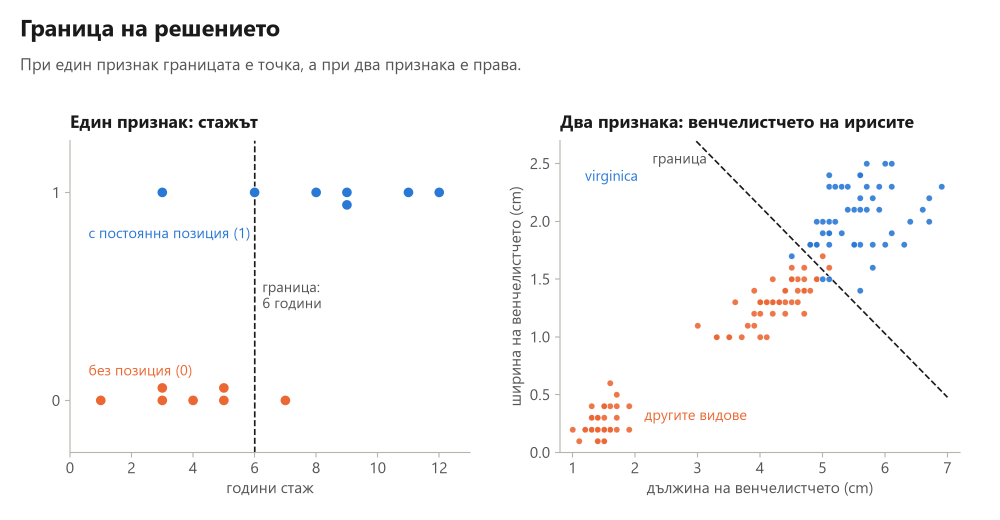

Вляво е стажът. Вдясно са 150 ириса, начертани по дължината и ширината на венчелистчето. Сините са от вида virginica, оранжевите са от другите два вида. Една права ги разделя почти без грешка.

### Линейно разделими данни

Данните са **линейно разделими** (linearly separable), ако има граница (точка при един признак, права при два), която разделя класовете без нито една грешка. Стажът не е линейно разделим: заради двете изключения няма точка, която да остави всички нули отляво и всички единици отдясно.

Това е нормално за реални данни. Затова от добрия модел се иска не само отговор, но и **колко е сигурен** в него.

> **Накратко.** Класификацията избира клас. Моделът разделя пространството на признаците на области с граница. При реални данни границата обикновено греши за някои примери.

## 2. Перцептронът: знакът на една сума

**Перцептронът** е най-простият линеен класификатор. Той умножава всеки признак по свое **тегло** (weight), събира всичко и добавя **свободен член** (bias):

$$
z = w_1 x_1 + w_2 x_2 + \dots + w_p x_p + b = w^\top x + b
$$

Положителното тегло дърпа към положителния клас, отрицателното към отрицателния, а тегло 0 означава, че признакът не влияе. Перцептронът използва класове +1 и -1 и гледа само **знака** на z: ако z > 0, предсказанието е $\hat y = +1$, а иначе $\hat y = -1$. Затова границата на решението е там, където z = 0.

Перцептронът се учи от грешките си. Той минава през примерите един по един. Когато познае, не прави нищо. Когато сгреши, поправя теглата така:

$$
w = w + \eta \, y \, x, \qquad b = b + \eta \, y
$$

Тук $y$ е истинският клас, +1 или -1, а $\eta$ (ета) е малко положително число, **скоростта на обучение** (learning rate). Тя казва колко голяма е една поправка. Знакът на $y$ казва накъде е поправката:

- пропуснат положителен пример ($y = +1$, а моделът е казал -1) се **добавя** към теглата;
- погрешно приет отрицателен пример ($y = -1$, а моделът е казал +1) се **изважда** от теглата.

Добавянето обръща теглата към примера и следващия път z за него е по-голямо. Изваждането прави обратното.

Ако класовете са означени с 1 и 0 вместо с +1 и -1, същото правило се записва като

$$
w = w + \eta \, (y - \hat y) \, x
$$

където $\hat y$ е предсказаният клас. Този запис може да се прилага на всеки пример, без да се проверява дали има грешка. При верен отговор $y - \hat y = 0$ и нищо не се променя. При грешка $y - \hat y$ е +1 или -1 и пак казва посоката.

Едно минаване през всички примери се нарича **епоха** (epoch).

### Разлика с линейната и логистичната регресия

И трите модела смятат една и съща сума $z = w^\top x + b$. Различават се по това какво правят с нея.

- **Линейната регресия** предсказва самото число z. Тя иска z да е възможно най-близо до истинската стойност и затова поправя теглата при всяко отклонение, дори малко. Перцептронът предсказва клас, а не число. За него е важно само дали знакът на z е верен, затова поправя теглата само при грешен клас.
- **Логистичната регресия** има същата граница z = 0, но превръща z във **вероятност** ([раздел 4](#sigmoida)). Перцептронът казва само "да" или "не". Преподавател с 6 години стаж и преподавател с 12 години получават един и същ отговор +1, макар за втория позицията да е много по-сигурна. Има и още една разлика. Ако данните не могат да се разделят без грешка, перцептронът не спира да сменя теглата, а логистичната регресия намира една най-добра граница.

### Пример: стаж и публикации

В [раздел 1](#klasifikatsiya) стажът сам не разделя преподавателите заради двете изключения. Нека за всеки преподавател се знае и втори признак: броят на публикациите му. Сега всеки преподавател е точка в равнината, а границата е права.

| стаж (години) | 1 | 3 | 3 | 3 | 4 | 5 | 5 | 6 | 7 | 8 | 9 | 9 | 11 | 12 |
|---|---:|---:|---:|---:|---:|---:|---:|---:|---:|---:|---:|---:|---:|---:|
| публикации | 4 | 2 | 5 | 18 | 10 | 6 | 8 | 12 | 3 | 9 | 7 | 11 | 6 | 5 |
| **клас** | -1 | -1 | -1 | +1 | -1 | -1 | -1 | +1 | -1 | +1 | +1 | +1 | +1 | +1 |

Клас +1 означава постоянна позиция. Изключенията вече имат обяснение: преподавателят с 3 години стаж и позиция има 18 публикации, най-много от всички, а този със 7 години без позиция има само 3.

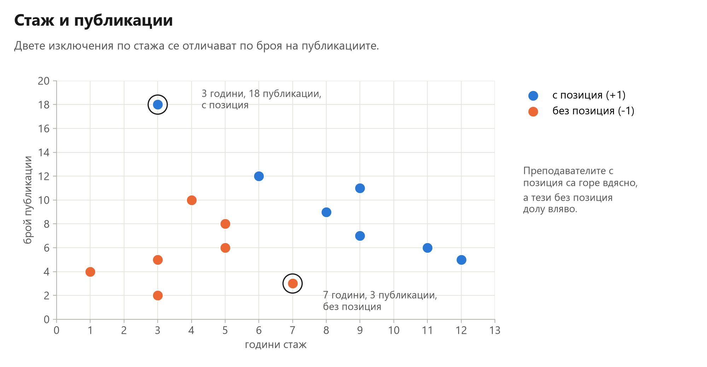

На графиката стажът е по хоризонталната ос, а публикациите по вертикалната. Преподавателите с позиция са горе вдясно, а тези без позиция долу вляво. Двете изключения, оградени на графиката, вече не пречат: първото е високо горе, второто е ниско долу. Затова има права, която разделя двата цвята без грешка.

Перцептронът започва с $w = (0, 0)$ и $b = 0$ и минава през преподавателите в реда от таблицата, с η = 1. В началото z = 0 за всички. Нулата не е по-голяма от 0, затова всички получават -1.

Първите трима преподаватели нямат позиция и -1 е верен отговор. Първата грешка е четвъртият, с 3 години и 18 публикации. Той има позиция ($y = +1$), затова се добавя към теглата:

$$
w = (0, 0) + 1 \cdot (3, 18) = (3, 18), \qquad b = 0 + 1 = 1
$$

Следващият преподавател има 4 години и 10 публикации и няма позиция. За него $z = 3 \cdot 4 + 18 \cdot 10 + 1 = 193 > 0$, т.е. моделът погрешно казва +1. Сега $y = -1$ и примерът се изважда:

$$
w = (3, 18) - (4, 10) = (-1, 8), \qquad b = 1 - 1 = 0
$$

Правата след тези две поправки е лоша: тя дава позиция на всички и греши за седемте преподаватели без позиция. Перцептронът продължава да минава през таблицата отново и отново. След 29 епохи и общо 143 поправки спира да греши с

$$
w = (5, 2), \qquad b = -49
$$

т.е. предсказва позиция, когато 5 · стаж + 2 · публикации - 49 > 0. За преподавателя с 3 години и 18 публикации z = 15 + 36 - 49 = 2 > 0, а за този със 7 години и 3 публикации z = 35 + 6 - 49 = -8 < 0. Теглата имат и прост смисъл: една година стаж тежи колкото 2.5 публикации.

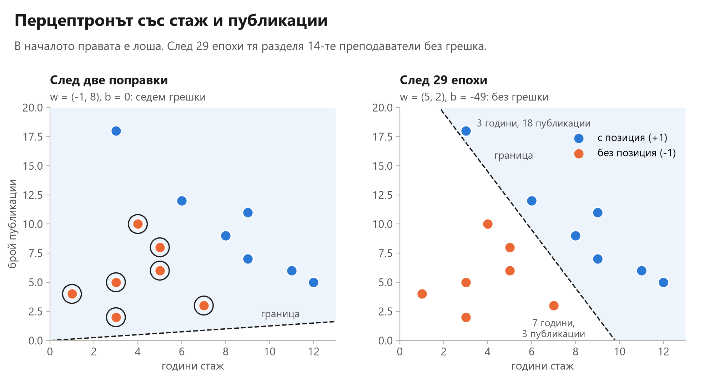

Перцептронът спря, защото с два признака данните са **линейно разделими**: правата 5 · стаж + 2 · публикации = 49 ги разделя без грешка. За такива данни е доказано, че перцептронът намира граница без грешки след краен брой поправки. След това той вече не греши и теглата не се променят.

Само със стажа данните не са разделими. Тогава винаги остава поне една грешка, всяка грешка мести теглата и перцептронът не спира.

Разделящите прави обикновено са много. Коя от тях ще намери перцептронът, зависи от реда, в който минава през примерите.

В следващите раздели примерът отново е само със стажа, за да се смята лесно на ръка.

> **Накратко.** Перцептронът смята z = wᵀx + b и предсказва знака му. Учи се само от грешките: w = w + η · y · x, т.е. пропуснатият положителен пример се добавя към теглата, а погрешно приетият отрицателен се изважда. За разлика от линейната регресия предсказва клас, а не число, а за разлика от логистичната регресия не казва колко е сигурен. При линейно разделими данни намира граница без грешки и спира, а при неразделими не спира.

## 3. Защо не линейна регресия

Първата идея за вероятност е линейната регресия: класовете 0 и 1 се третират като числа и през тях се прекарва права с най-малки квадрати. Прогнозата се тълкува като вероятност, а клас 1 се предсказва, ако прогнозата е поне 0.5.

За стажа правата е

$$
\hat y = -0.150 + 0.106 x
$$

където x е стажът в години. Тя стига 0.5 при 6.14 години, т.е. дава почти същото правило като "поне 6 години". Проблемите са два.

**Първо, прогнозите излизат извън интервала от 0 до 1.** При 0 години правата дава -0.15, при 12 години 1.12, а при 20 години 1.97. Вероятност -0.15 или 1.97 няма смисъл.

**Второ, очевидните примери местят правата.** Нека се добавят двама преподаватели с 25 и 30 години стаж, и двамата с позиция. Те не носят нова информация: и без тях е ясно, че с толкова стаж позицията е почти сигурна. Правата обаче се променя силно:

| | наклон | правата стига 0.5 при |
|---|---:|---:|
| 14 преподаватели | 0.106 | 6.14 години |
| с двамата нови | 0.035 | 7.05 години |

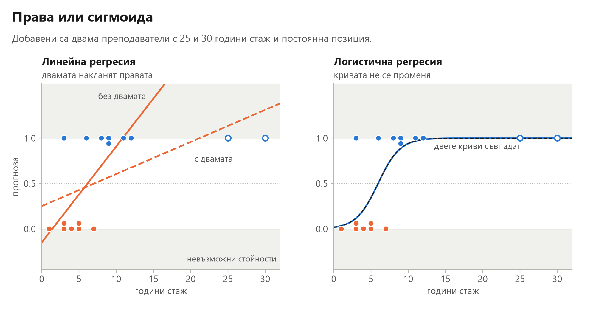

Защо правата се накланя? Старата права прогнозира 3.03 при 30 години, а истинската стойност е 1. Остатъкът е -2.03, а квадратът му е 4.1. Сумата от квадратите на всички 14 стари остатъка е само 1.91. Един нов пример тежи повече от два пъти колкото всички стари заедно. Най-малките квадрати не могат да оставят такава грешка и накланят правата към новите точки.

При класификацията обаче прогноза 3 за преподавател с позиция не е грешка. Класът е познат. Моделът просто е "прекалено сигурен", а линейната регресия го наказва за това.

Логистичната регресия (вдясно) решава и двата проблема: кривата ѝ винаги е между 0 и 1, а двамата нови преподаватели не я променят. Следващите два раздела показват как.

> **Накратко.** Права през нули и единици дава "вероятности" под 0 и над 1, а лесни далечни примери я накланят. Нужна е крива, която остава между 0 и 1.

## 4. Сигмоидата

Нужна е функция, която:

- приема всяко число z, колкото и голямо или малко да е;
- връща число между 0 и 1, което може да се тълкува като вероятност;
- расте: по-голямо z дава по-голяма вероятност.

Такава функция е **сигмоидата** (sigmoid), наричана още **логистична функция** (logistic function):

$$
\sigma(z) = \frac{1}{1 + e^{-z}}
$$

Тук $e \approx 2.718$ е основата на натуралния логаритъм. Как работи формулата:

- **z е голямо положително**, например 6. Тогава $e^{-6} \approx 0.0025$ е почти 0 и $\sigma(6) \approx 1 / 1 = 1$. Точната стойност е 0.998.
- **z = 0.** Тогава $e^{0} = 1$ и $\sigma(0) = 1 / 2 = 0.5$.
- **z е голямо отрицателно**, например -6. Тогава $e^{6} \approx 403$ е голямо и $\sigma(-6) = 1 / 404 \approx 0.002$.

| z | -6 | -2 | -1 | 0 | 1 | 2 | 6 |
|---|---:|---:|---:|---:|---:|---:|---:|
| σ(z) | 0.002 | 0.119 | 0.269 | 0.5 | 0.731 | 0.881 | 0.998 |

Сигмоидата никога не стига точно 0 или 1, само се приближава до тях. Освен това е симетрична около 0.5: $\sigma(-z) = 1 - \sigma(z)$. Например $\sigma(-1) = 0.269 = 1 - 0.731$.

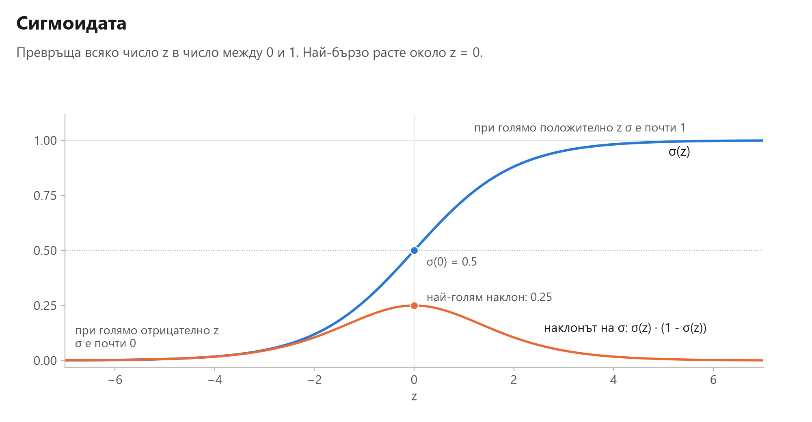

### Наклонът на сигмоидата

Производната на сигмоидата, т.е. наклонът на кривата, има проста формула:

$$
\sigma'(z) = \sigma(z) \, (1 - \sigma(z))
$$

Например при z = 1 сигмоидата е 0.731 и наклонът е 0.731 · 0.269 = 0.197. Наклонът е най-голям при z = 0, където е 0.5 · 0.5 = 0.25, и бързо пада към нула в двете посоки: 0.105 при z = 2 и 0.018 при z = 4.

Това има важен смисъл. Около z = 0 моделът не е сигурен и малка промяна на z променя вероятността много. Далеч от нулата моделът вече е сигурен и същата промяна на z почти не мени вероятността. Затова в [раздел 3](#zashto-ne-lineyna) двамата преподаватели с 25 и 30 години не местят кривата: за тях вероятността и без това е почти 1.

Откъде идва формулата за наклона

Сигмоидата е $\sigma(z) = (1 + e^{-z})^{-1}$. По правилото за производна на сложна функция

$$
\sigma'(z) = \frac{e^{-z}}{(1 + e^{-z})^2} = \frac{1}{1 + e^{-z}} \cdot \frac{e^{-z}}{1 + e^{-z}}
$$

Първият множител е $\sigma(z)$. Вторият е $\frac{(1 + e^{-z}) - 1}{1 + e^{-z}} = 1 - \sigma(z)$.

> **Накратко.** σ(z) = 1 / (1 + e⁻ᶻ) превръща всяко число във вероятност. При z = 0 дава 0.5, при голямо z почти 1, при малко z почти 0. Най-стръмна е около 0.

## 5. Логистичната регресия

Логистичната регресия съединява двете части: линейния резултат от перцептрона и сигмоидата.

$$
z = w^\top x + b,
\qquad
P(y = 1 \mid x) = \sigma(z) = \frac{1}{1 + e^{-(w^\top x + b)}}
$$

$P(y = 1 \mid x)$ се чете "вероятността класът да е 1 при признаци x". Често се означава кратко с $h(x)$. Вероятността за клас 0 е $1 - h(x)$.

Класът се избира по вероятността: 1, ако $h(x) \ge 0.5$, и 0 иначе. Сигмоидата е поне 0.5 точно когато z е поне 0, затова границата отново е там, където z = 0. Следователно логистичната регресия, както перцептронът, е **линеен класификатор**: границата ѝ е точка, права или хиперравнина. Новото е, че освен класа тя дава и вероятност.

Името "регресия" идва оттам, че моделът прогнозира число: вероятността. Класификатор той става, когато вероятността се сравни с праг ([раздел 13](#prag)).

### Моделът за стажа

С 14-те преподаватели обучението (как, е обяснено в [раздел 7](#pravdopodobie) и [раздел 8](#gradient)) дава b = -4.04 и w = 0.68. За преподавател с x години стаж

$$
z = -4.04 + 0.68 x,
\qquad
h(x) = \sigma(-4.04 + 0.68 x)
$$

| години стаж | 1 | 3 | 5 | 6 | 7 | 9 | 12 |
|---|---:|---:|---:|---:|---:|---:|---:|
| z | -3.36 | -2.00 | -0.64 | 0.04 | 0.71 | 2.07 | 4.11 |
| P(позиция) | 0.034 | 0.119 | 0.344 | 0.509 | 0.671 | 0.888 | 0.984 |

Например за преподавател с 1 година стаж z = -4.04 + 0.68 = -3.36 и

$$
\sigma(-3.36) = \frac{1}{1 + e^{3.36}} = \frac{1}{1 + 28.8} \approx 0.034
$$

Границата е там, където z = 0, т.е. $-4.04 + 0.68 x = 0$. Оттук $x = -b / w = 4.039 / 0.679 \approx 5.95$ години.

Моделът предсказва позиция от 6 години нататък и греши за същите двама преподаватели като правилото "поне 6 години". Разликата е, че сега се вижда колко е сигурен. За преподавателя с 3 години и позиция вероятността е 0.119: моделът казва "малко вероятно, но възможно". За преподавателя със 7 години без позиция вероятността е 0.671: "по-скоро да".

### В scikit-learn

`LogisticRegression` дава трите неща поотделно:

- `predict_proba(X)` връща вероятностите за двата класа, като втората колона е $h(x)$;
- `predict(X)` връща класа, т.е. 1, ако $h(x) \ge 0.5$;
- `decision_function(X)` връща z.

По подразбиране scikit-learn добавя към обучението **регуляризация**, която свива теглата ([раздел 9](#razdelimi)). Числата в този документ са без нея, с `LogisticRegression(C=np.inf)`. В по-стари версии на scikit-learn същото се постига с `penalty=None`.

> **Накратко.** Логистичната регресия смята z = wᵀx + b и го превръща във вероятност със сигмоидата. Границата е при z = 0, както при перцептрона, но моделът казва и колко е сигурен.

## 6. Шансове и logit

### Шансове

Сигурността може да се опише не само с вероятност, но и с **шансове** (odds): колко пъти събитието е по-вероятно от обратното.

$$
\text{odds} = \frac{p}{1 - p}
$$

Шансовете са познати от залаганията. "Шансове 4 към 1" означава, че от 5 еднакво възможни случая в 4 събитието се случва, а в 1 не се случва. Тогава p = 4 / 5 = 0.8 и p / (1 - p) = 0.8 / 0.2 = 4.

| p | 0.1 | 0.2 | 0.5 | 0.8 | 0.9 | 0.99 |
|---|---:|---:|---:|---:|---:|---:|
| шансове p / (1 - p) | 0.111 | 0.25 | 1 | 4 | 9 | 99 |
| ln(шансове) | -2.197 | -1.386 | 0 | 1.386 | 2.197 | 4.595 |

- Вероятността е между 0 и 1.
- Шансовете са между 0 и безкрайност. Шансове 1 означават "50 на 50". Под 1 събитието е по-малко вероятно от обратното, а над 1 е по-вероятно.
- Логаритъмът от шансовете може да е всяко число. При p = 0.5 той е 0, а при p и 1 - p е с еднаква големина и обратен знак: ln 4 = 1.386 при p = 0.8 и ln 0.25 = -1.386 при p = 0.2.

### Logit

Функцията

$$
\operatorname{logit}(p) = \ln \frac{p}{1 - p}
$$

се нарича **logit** или **логаритъм от шансовете** (log-odds). Тя превръща вероятност в произволно число. Сигмоидата прави обратното: превръща произволно число във вероятност. Двете функции са **обратни** една на друга: ако $p = \sigma(z)$, то $\operatorname{logit}(p) = z$. Например σ(1.386) = 0.8 и logit(0.8) = 1.386.

Защо logit и сигмоидата са обратни

От $p = \frac{1}{1 + e^{-z}}$ следва $p \, (1 + e^{-z}) = 1$, т.е. $p \, e^{-z} = 1 - p$ и $e^{-z} = \frac{1 - p}{p}$. Обърнато, $e^{z} = \frac{p}{1 - p}$, а след логаритмуване $z = \ln \frac{p}{1 - p} = \operatorname{logit}(p)$.

Оттук идва друг, много полезен поглед към логистичната регресия:

$$
\ln \frac{P(y = 1 \mid x)}{1 - P(y = 1 \mid x)} = w^\top x + b
$$

**Логаритъмът от шансовете е линейна функция на признаците.** Това е "линейното" в логистичната регресия: правата не минава през вероятностите, а през логаритъма от шансовете.

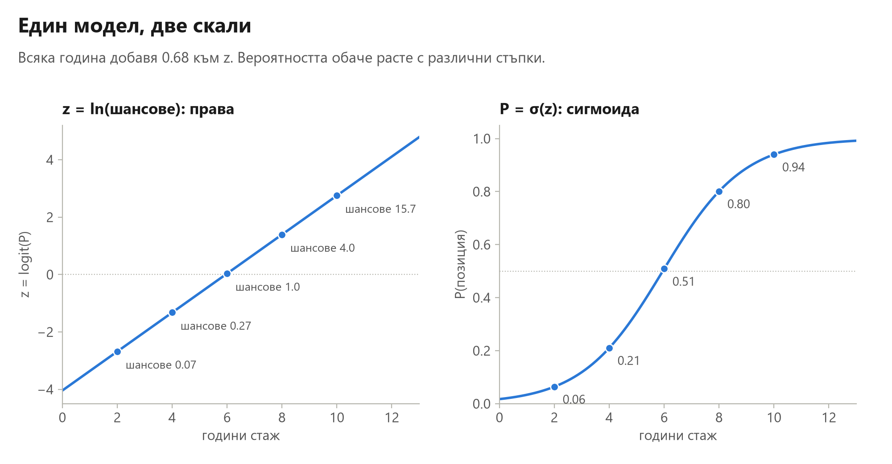

Вляво е z, т.е. логаритъмът от шансовете, спрямо стажа: права. Вдясно е вероятността σ(z) за същите години: сигмоида. Това е един и същ модел, начертан в две скали.

### Какво означава теглото w

При линейната регресия наклонът казва с колко се променя прогнозата, когато признакът нарасне с единица. Тук w казва с колко се променя **логаритъмът от шансовете**: всяка допълнителна година стаж добавя w = 0.68 към z.

Да се прибави 0.68 към логаритъма на едно число е същото като числото да се умножи по $e^{0.68}$. Причината е, че логаритъмът превръща умножението в събиране: $\ln(a \cdot b) = \ln a + \ln b$. Затова

$$
e^{w} = e^{0.68} \approx 1.97
$$

е **множителят на шансовете**: всяка година стаж почти удвоява шансовете за позиция. Вероятността обаче не расте с равни стъпки:

| години стаж | 5 | 6 | 7 | 8 |
|---|---:|---:|---:|---:|
| шансове | 0.53 | 1.04 | 2.04 | 4.03 |
| вероятност | 0.344 | 0.509 | 0.671 | 0.801 |
| промяна на вероятността | | +0.165 | +0.162 | +0.130 |

Шансовете растат с еднакъв множител, около 1.97. Вероятността расте най-бързо около границата и все по-бавно далеч от нея. Между 11 и 12 години тя се мени само с 0.015, от 0.969 на 0.984, макар шансовете пак почти да се удвоят, от 30.9 на 60.9.

Затова w не бива да се тълкува като "с колко расте вероятността". Правилните тълкувания са две:

- **знакът** на w казва посоката: при положително w вероятността расте с признака, при отрицателно пада, а при w = 0 признакът не влияе;
- $e^{w}$ е **множителят на шансовете**, когато признакът нарасне с единица.

Свободният член b е логаритъмът от шансовете при x = 0. При 0 години стаж шансовете са $e^{-4.04} \approx 0.018$, а вероятността е 0.017.

При няколко признака тълкуването е като при множествената линейна регресия: $e^{w_j}$ е множителят на шансовете, когато $x_j$ нарасне с единица, а **останалите признаци са фиксирани**.

> **Накратко.** Шансовете са p / (1 - p), а logit е логаритъмът им. Логистичната регресия приема, че logit е линеен по признаците. Всяка единица от признака умножава шансовете по eʷ.

## 7. Как се избират теглата: правдоподобие

При линейната регресия правата се избира с най-малък RSS. Логистичната регресия дава вероятности, затова критерият е друг: **моделът е добър, ако е дал голяма вероятност на това, което наистина се е случило.**

### Вероятността на случилото се

За всеки пример се гледа вероятността, която моделът дава на **истинския** му клас:

- ако преподавателят има позиция (y = 1), това е $h(x)$;
- ако няма позиция (y = 0), това е $1 - h(x)$.

Двата случая се записват с една формула:

$$
p(y \mid x) = h(x)^{y} \, (1 - h(x))^{1 - y}
$$

При y = 1 вторият множител е на степен 0, т.е. е равен на 1, и остава $h(x)$. При y = 0 първият множител е 1 и остава $1 - h(x)$.

За модела на стажа:

| преподавател | h(x) = P(позиция) | вероятност на случилото се |
|---|---:|---:|
| 12 години, с позиция | 0.984 | 0.984 |
| 1 година, без позиция | 0.034 | 1 - 0.034 = 0.966 |
| 3 години, с позиция | 0.119 | 0.119 |
| 7 години, без позиция | 0.671 | 1 - 0.671 = 0.329 |

На първите двама моделът е дал голяма вероятност: случилото се е било очаквано. Последните двама са изключенията. На тях моделът е дал малка вероятност, т.е. те го "изненадват".

### Правдоподобие

Моделът трябва да обясни не един пример, а всички наведнъж. Затова се гледа вероятността моделът да даде точно наблюдаваните класове на **всички примери заедно**. Тя се нарича **правдоподобие** (likelihood).

Как се смята вероятност за няколко събития заедно? Общото правило е **верижното правило** (chain rule). За три събития A, B и C

$$
P(A, B, C) = P(A) \cdot P(B \mid A) \cdot P(C \mid A, B)
$$

Чертата $\mid$ се чете "при условие". $P(B \mid A)$ е вероятността на B, когато вече се знае, че A се е случило. Правилото е вярно винаги, но е неудобно: всеки множител може да зависи от всички предишни.

Логистичната регресия приема, че примерите са **независими**: класът на един преподавател зависи само от неговите собствени признаци, а не от класовете на другите преподаватели. Тогава условията отпадат, т.е. $P(B \mid A) = P(B)$ и $P(C \mid A, B) = P(C)$, и остава просто произведение:

$$
P(A, B, C) = P(A) \cdot P(B) \cdot P(C)
$$

Например нека моделът дава вероятност 0.9, 0.8 и 0.7 на истинските класове на три примера. Тогава правдоподобието е

$$
L = 0.9 \cdot 0.8 \cdot 0.7 = 0.504
$$

За m примера правдоподобието е произведението от вероятностите на случилото се за всички тях:

$$
L(w, b) = \prod_{i=1}^{m} h(x^{(i)})^{y^{(i)}} \, (1 - h(x^{(i)}))^{1 - y^{(i)}}
$$

Тук m е броят на примерите, $x^{(i)}$ и $y^{(i)}$ са признаците и класът на пример i, а $\prod$ означава произведение, както $\sum$ означава сума.

**Методът на максималното правдоподобие** (maximum likelihood estimation, MLE) избира теглата, при които L е най-голямо, т.е. теглата, при които наблюдаваните данни са най-вероятни.

### Сравнение на кандидати

Всяка двойка (b, w) задава една сигмоида. Ето четири кандидата за стажа:

| сигмоида | b | w | L | l = ln L |
|---|---:|---:|---:|---:|
| на всички дава 0.5 | 0 | 0 | 6.1 · 10⁻⁵ | -9.70 |
| стъпало при 6 години | -18 | 3 | 2.6 · 10⁻⁶ | -12.84 |
| по-полегата крива | -3 | 0.5 | 2.6 · 10⁻³ | -5.96 |
| логистичната регресия | -4.04 | 0.68 | 3.1 · 10⁻³ | -5.79 |

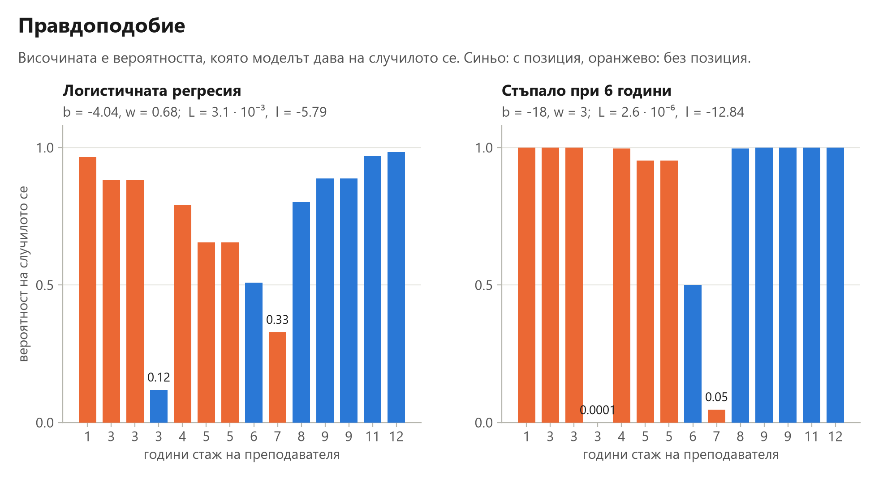

Най-поучително е стъпалото. То е почти сигурно навсякъде: дава вероятност почти 0 под 6 години и почти 1 над 6 години. За 12 от 14-те преподаватели това е отлично.

На преподавателя с 3 години и позиция обаче стъпалото дава вероятност 0.0001. Според него това почти не може да се случи, а то се е случило. Един такъв множител прави цялото произведение много малко. То става по-малко дори от това на безполезния модел, който на всички дава 0.5.

**Правдоподобието наказва силно увереността в грешен отговор.** Затова най-добрата сигмоида не е стъпало, а крива с умерен наклон, която оставя място за изключенията.

### Логаритъм от правдоподобието

Правдоподобието е произведение на много числа, по-малки от 1. Още при 14 примера то е около 0.003. При 1000 примера би било толкова малко, че компютърът ще го закръгли до 0. Затова се използва логаритъмът му, **логаритмичното правдоподобие** (log-likelihood):

$$
l(w, b) = \ln L(w, b) = \sum_{i=1}^{m} \Big[ y^{(i)} \ln h(x^{(i)}) + (1 - y^{(i)}) \ln \big(1 - h(x^{(i)})\big) \Big]
$$

- Логаритъмът превръща произведението в сума, а сумата е по-лесна за смятане.
- Логаритъмът е растяща функция, затова L и l имат максимум при едни и същи тегла.
- l е винаги отрицателно или 0, защото логаритъмът на число между 0 и 1 е отрицателен. По-близо до 0 означава по-добре.

В сумата се вижда и проблемът на стъпалото: само преподавателят с 3 години и позиция добавя ln 0.0001 ≈ -9.0, а общо стъпалото има l = -12.84.

### Log loss

В машинното самообучение по-често се търси минимум, отколкото максимум. Затова се използва и **log loss** (наричан още кръстосана ентропия, cross-entropy): средното на "минус логаритъма от вероятността на случилото се".

$$
\text{log loss} = -\frac{l(w, b)}{m}
$$

Да се максимизира l е същото като да се минимизира log loss. За модела на стажа log loss = 5.79 / 14 = 0.414. За сравнение, модел, който на всички дава 0.5, има log loss = ln 2 ≈ 0.693. В scikit-learn тази мярка е `sklearn.metrics.log_loss`.

> **Накратко.** Правдоподобието е вероятността моделът да даде истинските класове на всички примери заедно. При независими примери то е произведението от вероятностите на отделните примери. Логистичната регресия избира теглата, при които то е най-голямо. На практика се работи с логаритъма му, а минус средното на логаритъма е log loss.

## 8. Как се намира върхът: градиентно изкачване

### Хълмът

При линейната регресия RSS е купа и дъното ѝ се намира с формула. При логистичната регресия l(w, b) е **хълм** с един връх, но формула за върха няма. Затова той се търси на стъпки.

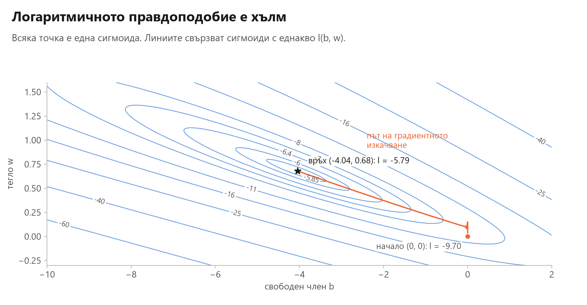

Всяка точка от графиката е една двойка (b, w), т.е. една сигмоида. Линиите свързват точки с еднакво l, като височинните линии на географска карта. Върхът е при b = -4.04 и w = 0.68, където l = -5.79.

Хълмът е издължен по диагонала. Причината е, че ако w се увеличи, а b се намали подходящо, границата -b / w остава почти на същото място. Тогава и l се променя малко.

### Градиент

**Градиентът** $\nabla l$ е векторът от частните производни на l по всяко тегло. Той сочи в посоката, в която l расте най-бързо, т.е. нагоре по хълма. **Градиентното изкачване** (gradient ascent) прави малка стъпка в тази посока, после отново смята градиента и т.н.:

$$
w = w + \alpha \, \nabla_w l(w)
$$

α е скоростта на обучение. Знакът е **плюс**, защото се търси максимум. При RSS знакът е минус, защото там се слиза към дъното на купа (градиентно спускане).

### Формулата за един пример

Ако се гледа само един пример (x, y), производната на l по теглото $w_j$ е изненадващо проста:

$$
\frac{\partial l}{\partial w_j} = (y - h(x)) \, x_j
$$

и правилото за обновяване е

$$
w_j = w_j + \alpha \, (y - h(x)) \, x_j
$$

За свободния член b се използва същото правило с $x_j = 1$. Обучението с по един пример на стъпка се нарича **стохастично** градиентно изкачване. В scikit-learn това е `SGDClassifier(loss="log_loss")`.

Множителят $y - h(x)$ е "изненадата" на модела:

- преподавател с позиция (y = 1), на когото моделът е дал 0.9: изненадата е 0.1 и теглата се местят малко;
- преподавател с позиция, на когото моделът е дал 0.1: изненадата е 0.9 и теглата се местят много;
- пример, за който моделът е сигурен и прав, почти не променя теглата. Затова двамата преподаватели с 25 и 30 години стаж не местят кривата.

Откъде идва производната

За един пример $l = y \ln h + (1 - y) \ln (1 - h)$, където $h = \sigma(z)$ и $z = w^\top x + b$. По правилото за производна на сложна функция

$$
\frac{\partial l}{\partial w_j} = \left( \frac{y}{h} - \frac{1 - y}{1 - h} \right) \cdot \frac{\partial h}{\partial w_j}
$$

От формулата за наклона на сигмоидата $\frac{\partial h}{\partial w_j} = h \, (1 - h) \, x_j$. След умножение

$$
\frac{\partial l}{\partial w_j} = \big( y \, (1 - h) - (1 - y) \, h \big) \, x_j = (y - h) \, x_j
$$

Именно свойството $\sigma' = \sigma \, (1 - \sigma)$ съкращава дробите.

### Една стъпка на ръка

В началото b = 0 и w = 0. Тогава z = 0 и $h(x) = 0.5$ за всички преподаватели. Нека първият пример е преподавател с 8 години стаж и позиция, а α = 0.01:

- изненадата е $y - h = 1 - 0.5 = 0.5$;
- новото b е $0 + 0.01 \cdot 0.5 \cdot 1 = 0.005$;
- новото w е $0 + 0.01 \cdot 0.5 \cdot 8 = 0.04$.

Теглото на стажа е станало положително: този пример "казва", че повече стаж означава повече шансове за позиция.

Оранжевият път на графиката с хълма е градиентно изкачване, при което всяка стъпка използва всички 14 примера наведнъж, с α = 0.01. Първата стъпка мести само w: в началото сумата на изненадите е $7 \cdot 0.5 - 7 \cdot 0.5 = 0$, затова b не се променя. След 100 стъпки (b, w) = (-1.40, 0.29), след 1000 стъпки (-3.81, 0.64), а след 5000 стъпки (-4.04, 0.68), т.е. върхът.

### Три правила с една и съща форма

| модел | предсказание | правило за обновяване |
|---|---|---|
| перцептрон (класове 0 и 1) | 1, ако wᵀx + b > 0, иначе 0 | w = w + η (y - ŷ) x |
| линейна регресия (LMS) | wᵀx + b | w = w + α (y - ŷ) x |
| логистична регресия | σ(wᵀx + b) | w = w + α (y - h(x)) x |

Трите правила изглеждат еднакво: теглата се местят по посоката на примера, пропорционално на грешката. Правилото за линейната регресия се нарича **LMS** (least mean squares). Алгоритмите обаче са различни, защото предсказанието е различно:

- перцептронът поправя само при грешка и винаги с цяла стъпка;
- линейната регресия поправя при всяко отклонение от числото y, дори когато класът е познат;
- логистичната регресия поправя винаги, но толкова, колкото е изненадана: много при уверена грешка и почти никак при уверен верен отговор.

Сходството не е случайно. Линейната и логистичната регресия са примери от едно по-широко семейство, **обобщените линейни модели** (generalized linear models, GLM), и за всички тях се получава правило с тази форма.

> **Накратко.** l(w, b) е хълм. Градиентното изкачване се качва по него с малки стъпки. За един пример стъпката е α (y - h(x)) x: колкото по-изненадан е моделът, толкова повече се местят теглата.

## 9. Когато данните се разделят без грешка

Ако се вземат само шестима преподаватели, трима с 1, 2 и 4 години стаж без позиция и трима с 6, 8 и 9 години с позиция, данните стават линейно разделими. Всяка граница между 4 и 6 години ги разделя без грешка, например 5 години.

Всички сигмоиди с b = -5w имат граница точно при 5 години, защото z = w (x - 5) е 0 при x = 5. Те се различават по стръмността. Колкото е по-голямо w, толкова по-стръмна е кривата и толкова по-голямо е правдоподобието:

| w | 0.5 | 1 | 2 | 5 | 10 |
|---|---:|---:|---:|---:|---:|
| l | -1.60 | -0.76 | -0.26 | -0.013 | -0.0001 |

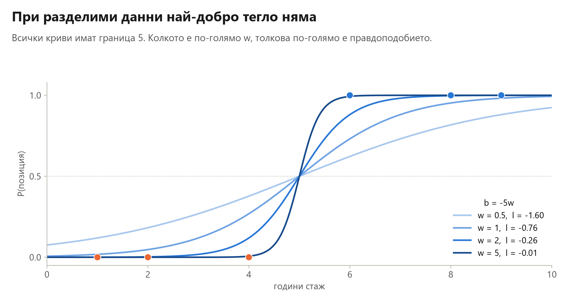

l расте към 0, но никога не го достига. По-стръмната крива дава по-голяма вероятност на всеки пример, защото всички примери са от правилната страна. **Най-добро тегло няма**: колкото и голямо да е w, по-голямо w е още по-добро. "Най-добрата" крива би била стъпало с безкрайно големи тегла.

Методът за обучение спира, когато подобрението стане незначително. С `LogisticRegression(C=np.inf)` се получава b = -37.7 и w = 7.56. Моделът е прекалено сигурен: дава вероятност под 0.001 при 4 години и над 0.999 при 6 години, макар да е видял само шестима преподаватели.

Решението е **регуляризацията** (regularization): към обучението се добавя наказание за големи тегла. Тогава максимумът съществува и теглата остават умерени. В scikit-learn регуляризацията е включена по подразбиране, а параметърът C определя силата ѝ: по-малко C означава по-силно наказание. С `LogisticRegression()`, т.е. с C = 1, се получава b = -4.94 и w = 0.99: границата е пак при 5 години, но увереността е умерена. Регуляризацията е отделна тема и тук е само спомената.

Разделимите данни не са рядкост. При много признаци, например когато всяка дума в текст е отделен признак и думите са хиляди, почти винаги има хиперравнина, която разделя обучаващите примери без грешка. Затова регуляризацията обикновено се оставя включена.

> **Накратко.** Ако данните се разделят без грешка, правдоподобието расте без край с теглата и максимум няма. Регуляризацията наказва големите тегла и прави модела по-малко самоуверен.

## 10. Два признака

При два признака

$$
z = b + w_1 x_1 + w_2 x_2
$$

и границата z = 0 е права. За ирисите от вида virginica срещу другите два вида, по дължината $x_1$ и ширината $x_2$ на венчелистчето в сантиметри, логистичната регресия дава

$$
z = -45.33 + 5.76 x_1 + 10.46 x_2
$$

Моделът познава вида на 144 от 150-те цветя.

### Линии с еднаква вероятност

Вероятността зависи само от z. Затова цветята с еднакво z имат еднаква вероятност, а точките с еднакво z образуват права. Например:

- P = 0.5 там, където z = 0. Това е границата.
- P = 0.9 там, където z = logit(0.9) = ln 9 ≈ 2.2.
- P = 0.1 там, където z = logit(0.1) ≈ -2.2.

Трите прави имат едни и същи тегла $w_1$ и $w_2$ и се различават само по константата. Затова са **успоредни**.

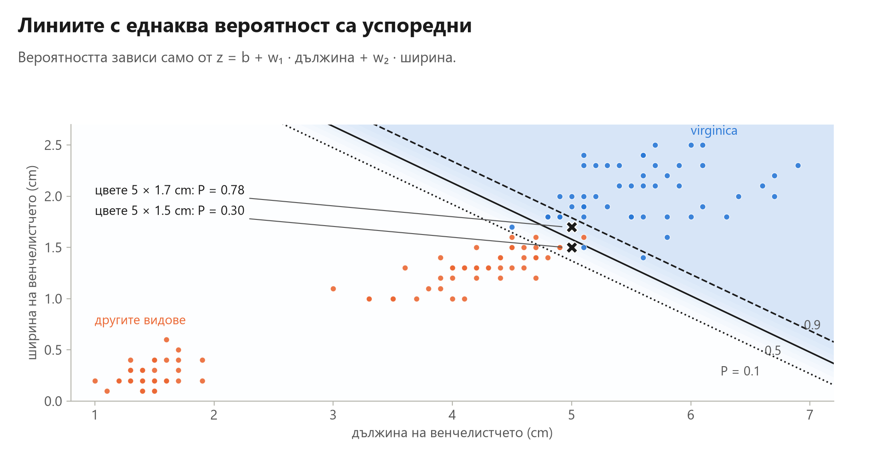

Вероятността се мени само при движение напреко на линиите, т.е. по посоката на w. По дължината на една линия тя е постоянна.

Двете цветя с хиксове са дълги по 5 cm. Ширина 1.5 cm дава P = 0.30, а ширина 1.7 cm дава P = 0.78. Разликата от 2 mm увеличава z с 10.46 · 0.2 ≈ 2.09, т.е. умножава шансовете по $e^{2.09} \approx 8$: от 0.44 на 3.5.

Ивицата между линиите 0.1 и 0.9 показва къде моделът не е сигурен. Тя е тясна, защото теглата са големи. Извън нея моделът е почти сигурен.

> **Накратко.** При два признака границата е права. Линиите с еднаква вероятност са успоредни на нея, а вероятността се мени само по посоката на w.

## 11. Повече от два класа: едно срещу всички

Логистичната регресия отговаря на въпрос с два отговора, а ирисите са три вида. Най-простият начин е **едно срещу всички** (one-vs-rest, OvR): обучават се три отделни двоични модела,

- setosa срещу другите два вида;
- versicolor срещу другите два вида;
- virginica срещу другите два вида.

Всеки модел k дава свой линеен резултат

$$
z_k = w_k^\top x + b_k, \qquad k = 1, \dots, K
$$

където K е броят на класовете. Колкото по-голямо е $z_k$, толкова повече примерът прилича на клас k. Предсказанието е класът с най-голям резултат:

$$
\hat y = \arg\max_k z_k
$$

$\arg\max_k$ означава "това k, при което стойността е най-голяма".

Защо не просто "класът, чийто модел казва да"? Всеки двоичен модел дели равнината на две области: "да" ($z_k > 0$) и "не". Областите "да" на различните модели могат да се застъпват, т.е. два модела да казват "да" за едно и също цвете. Може и някое цвете да е извън всички области "да". Сравнението на резултатите дава отговор и в двата случая.

### Пример с чашелистчето

Тук признаците са дължината и ширината на **чашелистчето**, стандартизирани: от всеки признак е извадено средното и резултатът е разделен на стандартното отклонение. По чашелистчето versicolor и virginica се застъпват много, затова задачата е по-трудна, отколкото по венчелистчето. Три цветя:

| цвете (дължина × ширина, cm) | истински вид | z setosa | z versicolor | z virginica | предсказание |
|---|---|---:|---:|---:|---|
| 5.1 × 3.5 | setosa | 22.99 | -2.49 | -3.52 | setosa |
| 5.7 × 2.8 | versicolor | -24.15 | -0.17 | -1.44 | versicolor |
| 6.2 × 2.2 | versicolor | -64.00 | 1.83 | 0.31 | versicolor |

- За първото цвете само моделът за setosa казва "да" (z > 0). Решението е лесно.
- За второто цвете и трите модела казват "не", т.е. то е извън трите области "да". Предсказанието е versicolor, защото неговото "не" е най-слабо: -0.17 е най-голямото от трите числа.
- За третото цвете два модела казват "да", т.е. то е там, където две области "да" се застъпват. Предсказанието е versicolor, защото неговото "да" е по-силно.

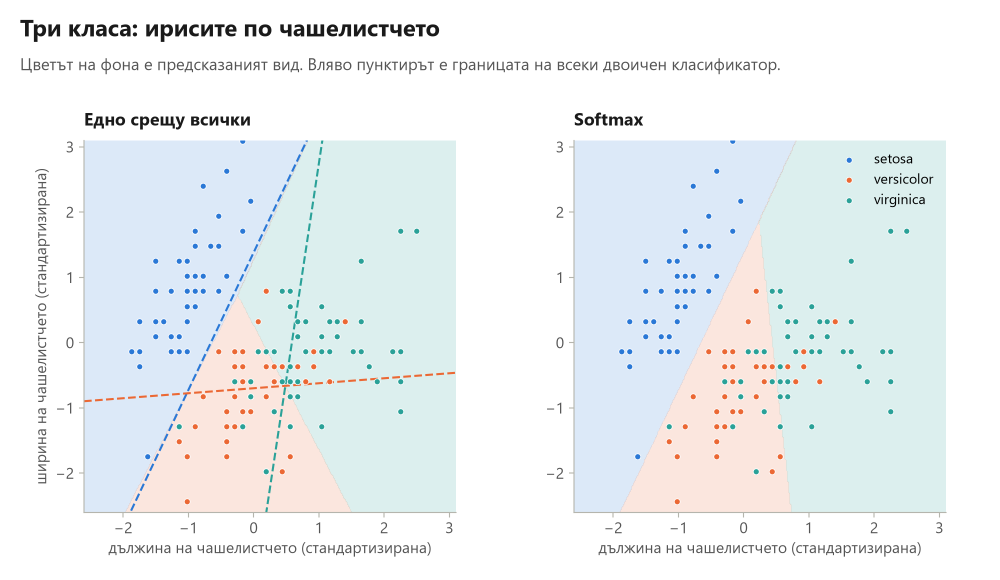

Вляво пунктирните прави са границите на трите двоични модела, всяка в цвета на своя вид. Цветните области са предсказанието след сравнението на трите резултата. Границите между областите не съвпадат с пунктира: те са там, където два резултата са равни. Върху същите 150 цветя едно срещу всички познава вида на 81% от ирисите.

Методът има и недостатък: трите модела са обучени поотделно, а резултатите им не са вероятности и не са в една и съща скала. Резултатът на setosa стига 23, защото setosa се отделя лесно.

> **Накратко.** Едно срещу всички обучава по един двоичен модел за всеки клас и избира класа с най-голям резултат. Резултатите не са вероятности.

## 12. Softmax

**Softmax** превръща K резултата във вероятности, които са положителни и се събират до 1:

$$
P(y = k \mid x) = \frac{e^{z_k}}{\sum_{j=1}^{K} e^{z_j}}
$$

Сметката има две стъпки:

1. Всеки резултат се повдига като степен на e. Така всички числа стават положителни, а по-голям резултат дава по-голямо число.
2. Всяко число се дели на сумата им. Така сумата става 1.

### Пример

За три класа с резултати z = (2, 1, 0):

| | клас 1 | клас 2 | клас 3 | сума |
|---|---:|---:|---:|---:|
| z | 2 | 1 | 0 | |
| eᶻ | 7.389 | 2.718 | 1.000 | 11.107 |
| вероятност eᶻ / сума | 0.665 | 0.245 | 0.090 | 1 |

Най-голяма вероятност има клас 1, затова $\hat y = 1$.

### Свойства

- **Редът се запазва.** Най-големият резултат дава най-голямата вероятност, затова предсказаният клас е същият като при $\arg\max_k z_k$.
- **Важни са само разликите.** Ако към всички резултати се прибави едно и също число, вероятностите не се променят: z = (3, 2, 1) дава пак (0.665, 0.245, 0.090). Причината е, че $e^{z + c} = e^{z} \, e^{c}$ и множителят $e^{c}$ се съкращава в дробта.
- **Един резултат влияе на всички вероятности.** Ако резултатът на клас 1 нарасне с 1, т.е. z = (3, 1, 0), вероятностите стават (0.844, 0.114, 0.042): на клас 1 расте, а на другите два пада.
- **Равни резултати дават равни вероятности.** z = (2, 2, 0) дава (0.468, 0.468, 0.063).

### Softmax и сигмоидата

При два класа с резултати (z, 0) softmax дава

$$
\frac{e^{z}}{e^{z} + e^{0}} = \frac{e^{z}}{e^{z} + 1} = \frac{1}{1 + e^{-z}} = \sigma(z)
$$

Например (1, 0) дава (0.731, 0.269), т.е. точно σ(1) и 1 - σ(1). Softmax е обобщение на сигмоидата за повече от два класа.

### Многокласова логистична регресия

**Многокласовата логистична регресия** (multinomial logistic regression) има по един вектор от тегла за всеки клас и превръща резултатите във вероятности със softmax. За разлика от едно срещу всички, теглата на всички класове се обучават **заедно**, с максимално правдоподобие: моделът се стреми да даде голяма вероятност на истинския вид на всяко цвете. В scikit-learn `LogisticRegression` прави това по подразбиране, когато класовете са повече от два, а едно срещу всички е `OneVsRestClassifier(LogisticRegression())`.

Границата между класовете k и ℓ е там, където двата резултата са равни: $z_k = z_\ell$, т.е.

$$
(w_k - w_\ell)^\top x + (b_k - b_\ell) = 0
$$

Това отново е права (хиперравнина). Затова и многокласовата логистична регресия разделя пространството с линейни граници. На графиката от [раздел 11](#edno-sreshtu-vsichki) вдясно са областите на softmax модела. Те са подобни на тези при едно срещу всички. Върху същите 150 цветя softmax моделът познава вида на 83% от ирисите.

> **Накратко.** Softmax превръща K резултата във вероятности със сума 1. При два класа съвпада със сигмоидата. Многокласовата логистична регресия обучава всички класове заедно и границите ѝ пак са прави.

## 13. От вероятност към решение: прагът

Логистичната регресия дава вероятност. Решението "клас 1" или "клас 0" идва от сравнение с **праг** (threshold): клас 1, ако вероятността е поне колкото прага. По подразбиране прагът е 0.5, но може да е всяко число между 0 и 1.

За стажа границата при праг t е там, където $\sigma(z) = t$, т.е. където $z = \operatorname{logit}(t)$:

| праг | logit(праг) | позиция се предсказва от |
|---:|---:|---:|
| 0.2 | -1.39 | 3.91 години |
| 0.5 | 0 | 5.95 години |
| 0.8 | 1.39 | 7.99 години |

Например при праг 0.8 условието е $-4.04 + 0.68 x = 1.39$, откъдето $x = (1.39 + 4.04) / 0.68 \approx 7.99$.

Смяната на прага не променя модела: теглата и вероятностите са същите. Мести се само границата. При по-нисък праг повече примери се обявяват за положителни. Така се хващат повече от истинските положителни, но се появяват и повече фалшиви тревоги. При праг 0.2 преподавателите с 4 и 5 години стаж вече се предсказват с позиция, макар да нямат. По-високият праг прави обратното.

Кой праг е подходящ, зависи от задачата, т.е. от това коя от двете грешки е по-скъпа.

> **Накратко.** Класът се получава от вероятността с праг. Прагът мести границата, без да променя модела.

## Речник

| Термин | На английски | Значение |
|---|---|---|
| класификация | classification | предсказване на клас вместо на число |
| клас | class | една от възможните стойности на отговора |
| положителен и отрицателен клас | positive and negative class | класът, който се търси (1), и останалият (0) |
| признак | feature | входна променлива $x_j$ |
| тегло | weight | $w_j$, колко и в каква посока признакът влияе на z |
| свободен член | bias, intercept | $b$, измества границата |
| линеен резултат | linear score | $z = w^\top x + b$ |
| граница на решението | decision boundary | мястото, където предсказаният клас се сменя; при линеен модел z = 0 |
| линейно разделими данни | linearly separable data | данни, които една права (хиперравнина) разделя без грешка |
| перцептрон | perceptron | линеен класификатор, който гледа знака на z |
| скорост на обучение | learning rate | $\eta$ или $\alpha$, колко голяма е една стъпка |
| епоха | epoch | едно минаване през всички обучаващи примери |
| сигмоида, логистична функция | sigmoid, logistic function | $\sigma(z) = 1 / (1 + e^{-z})$, превръща число във вероятност |
| логистична регресия | logistic regression | $P(y = 1 \mid x) = \sigma(w^\top x + b)$ |
| линеен класификатор | linear classifier | класификатор с граница точка, права или хиперравнина |
| шансове | odds | $p / (1 - p)$ |
| logit, логаритъм от шансовете | logit, log-odds | $\ln (p / (1 - p))$, обратната функция на сигмоидата |
| множител на шансовете | odds ratio | $e^{w}$, колко пъти се умножават шансовете при +1 на признака |
| верижно правило | chain rule | $P(A, B) = P(A) \cdot P(B \mid A)$: вероятност на няколко събития заедно |
| независими примери | independent examples | класът на всеки пример зависи само от неговите признаци; тогава вероятностите се умножават |
| правдоподобие | likelihood | вероятността на истинските класове на всички примери заедно; при независими примери произведение |
| логаритмично правдоподобие | log-likelihood | $l = \ln L$, сума вместо произведение |
| метод на максималното правдоподобие | maximum likelihood estimation, MLE | избира теглата с най-голямо правдоподобие |
| log loss, кръстосана ентропия | log loss, cross-entropy | $-l / m$, средната "изненада" на модела |
| градиент | gradient | векторът от частните производни; сочи посоката на най-бързо нарастване |
| градиентно изкачване | gradient ascent | търсене на максимум с малки стъпки по градиента |
| стохастичен градиент | stochastic gradient | стъпка по градиента на един пример |
| LMS | least mean squares | правилото за обновяване при линейната регресия |
| обобщени линейни модели | generalized linear models, GLM | семейството, към което принадлежат линейната и логистичната регресия |
| регуляризация | regularization | наказание за големи тегла |
| едно срещу всички | one-vs-rest, OvR | по един двоичен модел за всеки клас |
| softmax | softmax | превръща K резултата във вероятности със сума 1 |
| многокласова логистична регресия | multinomial logistic regression | логистична регресия със softmax, обучена за всички класове заедно |
| праг | threshold | вероятността, от която нататък се предсказва клас 1 |

## Източници

- G. James, D. Witten, T. Hastie, R. Tibshirani и J. Taylor, *An Introduction to Statistical Learning with Applications in Python*, Springer, 2023, глава 4.
- A. Ng, *CS229 Lecture Notes*, Stanford University: логистичната регресия като максимално правдоподобие, градиентното изкачване, сравнението с LMS и обобщените линейни модели.
- Документацията на scikit-learn: [LogisticRegression](https://scikit-learn.org/stable/modules/generated/sklearn.linear_model.LogisticRegression.html), [SGDClassifier](https://scikit-learn.org/stable/modules/generated/sklearn.linear_model.SGDClassifier.html) и [OneVsRestClassifier](https://scikit-learn.org/stable/modules/generated/sklearn.multiclass.OneVsRestClassifier.html).
- Данните за ирисите са на R. A. Fisher (1936) и се зареждат с `sklearn.datasets.load_iris`. Данните за стажа и публикациите са измислени за примерите. Фигурите са направени с тези данни и с `LogisticRegression(C=np.inf)`.
